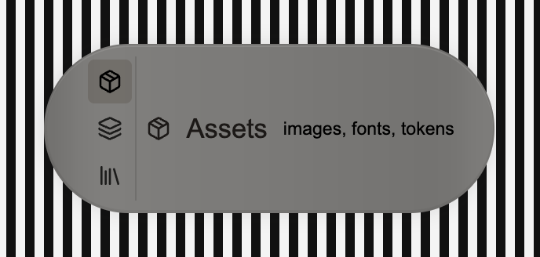

# W-I.8: the third build, measured

2026-11-15. Seat: the third build and measure. Model: claude-opus-5-5. I wrote none of the wave, the rulings, the challenges or the folds.

Paths below are relative to `docs/tranches/BL/design/dock/wi8/measure/` in the worktree `.claude/worktrees/bl/dock/wi8` (branch `bl/dock/wi8`), where the harness, rows and logs live. Gate numbers and bounds are `waves/W-I.8.md`'s as the second fold left them.

**Every reading below is on one build.** Its source is `516f591b0`; the commits after it change only the harness and add the evidence, and `logs/m3-build.sha` records the tree it was built from (`9a0fb1fc2`, `src` clean). The page was built once with `VITE_DOCK_HOLD=1` (`logs/m3-build.log`) and the library once without it (`logs/m3-build-lib.log`). Engines: headless Chromium (rows of about 8.3 ms) and Playwright WebKit 2287 (about 16.7 ms), at 1440 fine light and dark, 390 coarse by real touch, 360 coarse where a gate names it, reduced motion, and 4x CPU for the cost cell. 138 probe cells ran in each engine, every one; the side cells (clock, census, outlet, overlays, the second challenge's cells, crops, cost) ran once per engine. Shipping Safari is unread. A gate is GREEN only when it passes in both engines and its planted fault turns it RED.

The machine was at a load of 7 to 16 throughout. The WebKit lock was free for the pass itself; G-14's master run waited about 6 minutes for it and the rerun flow plant about 10, and an earlier attempt, on the build before the lanes' cure, waited 17 minutes for a release run. None passed the hour.

## The gates

The judges: `harness/m3/judge4.mjs` is `judge3.mjs` with two corrections (below); `m3/seat4.mjs` judges the open-seat cells; `read2.mjs` reads the faces, the return and the window's close; `m3/read3.mjs` reads the five behaviours, inside the plate as rounded shapes, and the window's first row; `g9b.mjs` the published progress. Logs are `logs/m3-*-chromium.*` and `logs/m3-*-webkit.*`. A plant is one fault planted in source (`m3/plants.py`), built, read on the gate's cells in both engines, and reverted (`m3/plantrun.sh`, `logs/m3-plant-*.txt`).

| gate | Chromium | WebKit 2287 | plant bites | verdict |
|---|---|---|---|---|
| G-1 · the clock | (a) opens 73.9 ms after the first move; (b) no open while the page scrolls under a still pointer, then 67 ms after a 2 px move; (c) 6515; (d) 12007, and 6004 with the max at 6 s; (e) no fold, then 6630; (f) a Popover and focus inside hold; (g) 6012; (h) press outside 2.9 ms, Escape 3.0 ms; (i) 6533, one fold; (j) no fold in 15 s; (k) 6532; (m) no fold under the pointer; (n) no reopen through movement, reopens after a leave and return; (o) the controls dock folds 3190 ms after the leave, the other never opens | (a) 68; (b) no open, then 68; (c) 6530; (d) 12005 and 6006; (e) 6655; (f) holds; (g) 6011; (h) 4 and 6 ms; (i) 6548; (j) holds; (k) 6541; (m) no fold; (n) as Chromium; (o) 3192 | yes, both: the linger token ignored folds at 3605 and 3607 ms | not GREEN: every cell read passes in both engines with its bite, but (l), a finger held in (f), `collapse()` in (h) and the 390 coarse clock did not run |
| G-2 · the fold and the unfold | 123 of 130 segments over 67 scenarios. Fails: the outlet's seat 3 (fine, dark, coarse) and fourier's seat 2 (fine, dark) hidden one row before covered; the card at 390, first row 44 ms after the tap; the pill in dark, the summary's fade 74 ms (bound 75). read3: content inside the curve within 0.02 px everywhere but one sliver (1.11 px, below); the rim within 0.5 px and 40 % in every row; every coarse cell tapped by touch; the transport open at rest by touch; the seven-seat dock 6 of 7 whole at 360 and 390. Outline in pixels: the fold within 0.56 to 0.73 px of a stadium at seven held points; the layer change within 0.69 to 0.96 px at six and 1.16 px at one; the tall dock 1.03 px | 121 of 130. Fails: the outlet's seat 3 and fourier's seat 2 as Chromium; the vertical pill's last row 0.33 to 0.36 px (fine, dark; floor 0.25); the rail in dark, first row 36 ms after the press outside. read3 as Chromium (the rim within 0.18 px). Outline unread: headless WebKit draws the glass without its blur and no pixel changes by more than 40 over the stripes | yes, both, for each of seven plants: the clock started at the trigger (16 % in the first row); the curve inset never written (8.29 px past the curve); the touch rule removed (the transport folded); never compact (4 of 7 whole); the rim on the root (76 px off); the leaving face sized by its border box (4 px in the first row); every lane corner rounded (1.62 px past the curve) | fails |
| G-3 · a reversal | 18 of 18. Leaves the old path 7.2 to 8.8 ms after the cause; at a quarter of a fold reverses at 23.2 ms against 30.7 | 16 of 18, leaving the old path 15 to 18 ms after the cause. Fails: a pointer return at a quarter of a fold reverses at 35 ms against 34, and a pointer leave at 75 % of an unfold at 18 against 17, one row each | in WebKit only: the intent wait applied to a return reverses at 66 ms against 36; Chromium reads both cells GREEN under the plant | fails |
| G-4 · a layer swap, the open seat, the seat set | 37 of 40. Fails: the region's seat 3 hidden one row; the seat set at 390, three rows hidden on the compact switch; value.js's swap at 390, first row 42 ms after the press. Open seat (`seat4`): every cell passes, neighbour, far end and twice within 90 ms with its retarget, at 1440, 390, 360, the ten-seat run and under reduced motion. Seat set: joins fade in over 185 ms, leaves out over 82 to 83 ms, no cut, no removed seat hidden. read3: at 1440 the open seat's name changes two seats' widths by 96 px in one row; at 390 the compact switch narrows the current seat by 104 px in one row | 37 of 40. Fails: the region's seat 3; the seat set at 390, two rows; a fold 90 ms into a swap, the edges leave their path 51 ms after the Escape. Open seat: every cell passes. Seat set and read3 as Chromium | yes, both, for four of five: the seat's 210 ms `inline-size` leg (twice within 90 ms, steps 8.8 % against 7.7 % and 18.9 % against 15.3 %); the records ignored (the seat cut in two rows, fades of 8 to 15 ms); the scroll offset left to the run's reach (whole-seat steps, 31.3 % in a row); the removed seat kept in the run's port (hidden before covered, judged by `judge4`). No bite for the fifth: the rest off the snap positions reads GREEN in both | fails |
| G-5 | retired | | | retired with R-6 |
| G-6 · the hover guard | the hover and sweep cell: root and plate move 0 px | the same | yes, both: the hovered seat 24 px wider moves the plate 96 px. The plant's first version (padding on the hovered seat) planted nothing, since the seat's width is fixed, and read GREEN; it was rewritten and rerun | not GREEN: 390 and keyboard focus did not run |
| G-7 · the outlet | contributed seats are the run's direct children after the authored ones, in mount order, mounted before or after the dock; the context is that dock's; the seat is roved; content leaves and returns with the dock; with nothing contributed `#persistent-end` takes 0 px; an outlet into a controls dock lands in its run; the lookup `git grep` prints nothing. The unit spec passes | the same | yes, both: the provide removed, the context is not the dock's | GREEN |
| G-8 · overlays | a menu, a select and a popover opened from the dock hold it through the linger; the first Escape closes the overlay with focus on its trigger, the second folds the dock with focus on the folded face; a press outside folds at once (8 ms) and the popover's exit ends at 132 ms, before the plate lands at 283 ms; a dialog and a sheet from a press-opened dock hold it, and focus returns to the seat that opened them, not inert. The overlay cells' folds hide the outlet's seat 3 for one row, as in G-2 | the same (fold at 14 ms, exit ended at 132, landing at 282) | yes, both: with the hold consulted, a press outside with the menu open folds nothing | not GREEN: Escape with a hover popover open (focus never entered the dock) and a press outside with the sheet open (the press lands on the sheet) are unread |
| G-9 · the published progress | 0 and 1 at rest, present in every row, 1 after a swap; the scope element equals the root in every row; the follower within 0 rows; no class change outside the window | the same | yes, both: the scope write removed, the follower 4 rows behind | GREEN |
| G-10 · reduced motion | 57 of 59. Fails: the two swap cells | 56 of 59. Fails: the two swap cells | yes, both: with geometry on the spring, every fade runs 217 to 252 ms | fails as judged. Each failing segment holds two or three changes 90 ms apart; the judge does not split them, which the wave's build order asks for |
| G-11 · cost, and rest | a median of 1 layout a frame, 4 on the trigger frame in every cell (bound 3); the loop's script 0.11 to 0.18 ms at the median at 1x and 4x; at rest 0 callbacks, 0 mutations, 0 animations; nodes the same folded and open (27 to 55). In block flow at 4x the longest layout is 1.18 ms against 0.94 | 73 of 5244 travel rows over 20 ms (1.4 %). Eight cells exceed one in ten: seven reduced-motion windows of 8 to 16 rows with 2 or 3 slow rows, and the held slider, 3 of 25 | yes (Chromium; rest is read there only): a loop left running at rest, 480 to 720 callbacks | fails, on the trigger frame's fourth layout (unnamed), the flow layout at 4x, and WebKit's pacing in eight short cells |
| G-12 · static | `g12.mjs`: thirteen clauses pass over `src` and the library build; `__dockHold` and `__dockPose` are absent from the built script (the declaration file `useDockBody.d.ts` names `__dockPose`). Two clauses of the wave fail: `useDockMorph.ts` and `dockMorphMeasure.ts` are present, and the plate's shadow reads `--dock-halo`, not `--dock-shadow-color` | (engine-free) | yes: a `scale` on `.glass-dock` | fails, on the deletions and the rename, neither built |
| G-13 · census, focus, hit, forced colours | the census the same collapsed, mid-travel, open and back at 360, 390 and 1440; every seat 44 px or more at 390; one Tab stop in a layer group, keys without wrap, re-derived on a swap; at collapsed rest no open seat has a rectangle, at open rest the folded face has none, no overflow either way; the docks meet at none of 360, 390, 1440; a controls dock is a named toolbar, none of its six seats clipped at 360; focus held through a fold lands on the folded face; forced colours: root 0 px, plate 1 px, light and dark | the same, forced colours aside (Chromium only) | yes, both: the hidden face keeps its box at rest, 5 of 5 seats with rectangles | not GREEN: the safe-area cell (a 34 px inset, `within="parent"` and `within="viewport"`) did not run |
| G-14 · the shipped line | dock unit specs: 274 pass and 1 expected failure of 275 (`logs/m3-units.log`). Release specs of 10.1.1 to 10.1.5 and 11.0.1, the worktree's set (it carries no 11.0.2 or 11.1.0 spec), against master's snapshot at the merge base `99a1389e6` (`.base-master`, run the same way): the build passes 328 of 552 (headless and coarse-touch projects), master 534. 206 tests fail on the build and pass on master (101 headless, 105 coarse), at 73 distinct test sites; none passes only on the build. By their first error, 46 sites read the root's computed corner as half the block extent (the build paints the corner on the plate; the root reads `9999px`), 12 read a reserve, fit or ring property the carrier removed (`NaN`) or its flag, 7 read a box edge on the first frame or a control painted outside the plate, 2 time out on a locator, and 6 read other things (the leaving summary's first frame among them). `logs/m3-g14-*.log`, compared by `m3/g14cmp.py` | the build passes 157 of 276 and fails 109 (10 skipped); master fails 10. 98 fail on the build and pass on master, in the same specs and describes as Chromium; none passes only on the build | yes: with reduced motion's clocks at 300 ms the restated witness (`GlassDock.motion-parity`, reduced motion mid-morph) fails. The plant's first version slowed only the content clock, which that witness does not read, and read GREEN; it was rewritten and rerun | fails. None of the 304 new failures is restated or listed with the law it now reads, which the gate asks for; they are not sorted here into restatements and faults |

Two gates are GREEN: G-7 and G-9. G-1 passes every cell it read in both engines with its bite, and is held back only by cells that did not run. Every other gate fails, or has a cell unread.

## The five behaviours

Each is built on its own commit and read by `read3.mjs` in both engines.

- **Content inside the curve of a tall dock** (R-1, C2-6, OQ-7's default). The carrier reads each child of the open run as the rounded shape it is and writes `--dock-curve-inset`, which pads the run in from the ends until every child lies inside the stadium. The two-row layer dock is 287.2 by 108 with a 25.75 px inset; a one-row dock is unchanged. At rest no unit lies outside the curve in any cell but one (below). In travel the lanes clip with the plate's rounding, and since this pass only on the corners they share with the plate. `fold/crop-tall-3.png` is the dock at open rest in Chromium:

  

- **A control joining or leaving an open dock** (R-3, C-5). A seat added by `v-if` enters on the entering window: it waits, then fades in over 183 to 185 ms in both engines, no step over 0.28 in 16.7 ms and no cut. A seat removed is held by glass where it painted, inert and out of the run's flow, in the run's region, and fades out over 82 to 84 ms; it is gone at the landing. A route that swaps the seat set does both at once. Under reduced motion both fades take 100 to 116 ms. No held control is hidden before the plate covers it in any row of either engine.
- **A dock with no folded face stays open under touch** (R-2). Under `(hover: none)` with no `collapsed` slot the dock rests open. keyframes's transport is open at rest by touch in both engines, which on F2 could not be opened at all in WebKit.
- **The compact run and the cap of six** (R-5, R-12, O-358). When the run does not fit with the current seat's name, the run is compact (the name gives way), and only then does it scroll. A seventh control in a `ControlsDock` is a development warning. Six controls at 360 are whole and unclipped in both engines. The seven-seat dock of O-358 is compact at 360 and 390 and still shows 6 of 7 seats whole: the last seat is a sliver (0.86 of it at 390, 0.18 at 360) in both engines, so G-2's "every seat whole, with no sliver" fails. Nothing narrower than the compact run is ruled.
- **The reading-progress rim** (RU-12). `ScrollProgressRim` takes `edge="border"` and goes in the plate's new `#rim` slot; it draws on the plate's border box with the plate's radius inherited. Its outline is within 0.5 px of the plate's outer edge in every row (Chromium) and within 0.18 px (WebKit), folded, open and through the travel, and its fill reads 40 % in every row.

## The readings the second fold left failing

- **The current seat moved twice at 390.** Cured, in three commits. At 390 the site dock is now compact and fits, so the scrolling case was moved to a ten-seat run (`w-long`) at 390. There the run's offset stepped a whole seat per row in both engines: in a compact run a change of open seat moves no seat, so the carrier never took the offset, and the run's own reach scrolled a mandatory-snap port that snapped each write. The carrier now carries the offset whenever the open seat changes in a scrolling run (`2a5a198f9`), rests it on the nearest snap position that keeps the seat in view, which ends WebKit's 21.75 px re-snap after a retarget (`a112ec8c8`), and decides compact from layout extents so it does not flip mid-travel (`fdd29d6d6`). Every open-seat cell passes `seat4.mjs` in both engines: neighbour, far end, twice within 90 ms with the retarget, at 1440, 390, 360 and on the ten-seat run.
- **A seat hidden by its lane before the plate covers it.** W-I.8 gives no ruling, so both clauses stand and the cells fail as before: one row on the outlet's seat 3 (fine, dark, coarse) and the region's seat 3 in both engines, and one row on fourier's seat 2 (fine and dark) in both. The seat-set cell at 390 adds two to three rows, from the compact switch below.
- **The fold reversed at a quarter.** The 35 against 34 ms of F2 was the judge's: a reversing step of exactly 0.01 px was dropped by float error, and the turn was timed from the mark rather than the tap. With both corrected (`judge4.mjs`) the cell passes in Chromium (reverses at 23.2 ms against 30.7). In WebKit on this build it reads 35 ms against 34, one row, and a turn at 75 % of an unfold reads 18 against 17; on the previous build, which differs only in the lanes' corners, the same WebKit cell passed. It sits on the row boundary in WebKit and is left failing.
- **The dip** (OQ-9). Left as asked. Read on this build: a turn at the middle leaves the strongest face under 0.3 for 58 to 83 ms (Chromium) and 100 ms (WebKit); a late return 99 ms; a quick third change 51 to 58 ms. A return to the face on screen stalls 35 to 67 ms before it rises (bound 34), which is the same window.

## Found and cured on the way

Three faults surfaced once the judge read every seat, each present on F2:

- **The leaving face dropped 4 px.** On every fold the open face's seats moved 4 px down in the first row: a content-box run was given its border-box height when it was placed out of flow. `620708b36`. Read by `read3.mjs`'s new first-row clause.
- **A removed seat was placed 24 px off and cut by the run.** The run is laid out for the new set when the mutation record arrives, so its rect was not where the seat painted; and a seat removed at the run's end was cut by the run's own scroll port in its first row. The seat is now placed from the run's origin at the last read and held in the run's region. `5c62df409`.
- **A narrow lane's corners were less round than the plate.** `round R` on all four corners of a lane narrower than 2R is scaled down by CSS on every corner, so a seat at the plate's end painted up to 1.6 px past its curve (read in both engines on the region cell under reduced motion). A lane now rounds only the corners it shares with the plate. `516f591b0`.

Still failing and not cured:

- **The compact switch and the open seat's name land in one row.** At 1440 a change of open seat changes two seats' widths by 96 px in one row (the name moves to the new seat); at 390, adding a seat that makes the run compact narrows the current seat by 104 px in one row. The seats' places glide; their widths do not. This is R-5's "the names on `f`", which is not built.
- **A scrolled sliver at the cap.** In the ten-seat run at 390, a seat cut by the run's scroll port at rest has square cut corners that lie 1.11 px past the plate's cap, in both engines. A rounded scroll port would end it, but the run's padding is the focus ring's room and a rounded port would clip the ring at the ends; not tried.
- **G-11's trigger frame** has four layouts in every cost cell (bound three, one unnamed), and the block-flow dock's longest layout at 4x is 1.18 ms against 0.94.

## The judge

`judge4.mjs` changes two things in `judge3.mjs`: a step counts from 0.005 px (half the sampler's resolution), so a reversing step of 0.01 px is not lost to float error; and a turn is timed from its cause, the first pointer event after the mark. `seat4.mjs` judges a retarget as one window with the change it follows. `read3.mjs` is new: the clipped shape of each unit (its own rounded box, cut by its visible box and by its lane's clip as CSS paints it, per-corner radii scaled as CSS scales them) against the plate's rounded box; every seat in the window's first row; the joining seat's fades; a removed seat visible until covered; the rim; whole seats at open rest; the touch log; and a dock with no folded face open at rest. The sampler keys seats by element, so a seat removed or re-inserted keeps its key and does not lend it to a neighbour; under the index keys F2's judge used, a route change read as a seat cut from 1 to 0 in a row. `sum2.mjs` judges `read2.mjs`'s values against the wave's bounds.

## What each commit changed

From `51c42f017` (F2's harness), hashes read from `git log` in the worktree.

| commit | what it changed | ruling | gates |
|---|---|---|---|
| `dc6f95eb8` | a control that joins the open run enters on the entering window; one the host removes is held where it painted (inert, out of flow, not a seat) and leaves on the leaving window, gone at the landing; the loop owns their opacity for the travel | R-3, C-5 | G-4 |
| `8e342772c` | a pill taller than one row pads its open face in from the ends until each child, read as its rounded shape, lies inside the curve (`--dock-curve-inset`) | R-1, C2-6 | G-2 |
| `797a6de55` | a dock with no folded face rests open for a pointer that cannot hover | R-2 | G-2 |
| `1d63bb143` | the compact run (the current seat one glyph wide when the run does not fit with its name), then scroll; a seventh control in a `ControlsDock` is a development warning | R-5, R-12, O-358 | G-2, G-13 |
| `c9107efad` | the reading-progress rim is the plate's child (`#rim`) and draws on the plate's border box with its radius inherited (`ScrollProgressRim edge="border"`) | RU-12 | G-2 |
| `fdd29d6d6` | the compact decision reads layout extents, not the scroll extent, which counted the seats' carry mid-travel and flipped compact on and off | R-5 | G-2 |
| `2a5a198f9` | the open seat changing in a scrolling run is a travel of the run's offset even when no seat moves; the carrier halts the run's reach and carries the offset | R-5 | G-4 |
| `a112ec8c8` | the run's resting offset is the nearest snap position that keeps the open seat in view | R-5 | G-4 |
| `d4de0d16f` | harness: four new cells, 138 scenarios (`gen4.mjs`), `judge4`, `seat4`, `read3`, the plants and their runner, the pass script | | all |
| `ec246ec78` | harness: G-14's runner (`m3/g14.sh`) | | G-14 |
| `620708b36` | a leaving face placed out of flow is sized by its content box when it is content-box | R-1, R-3 | G-2 |
| `5c62df409` | a removed control is placed from the run's origin at the last read and held in the run's region, out of the run's scroll port | R-3, C-5 | G-4 |
| `abf2a42c9` | harness: seats keyed by element, the ghost track, the curve on the clipped shape, the first-row clause, two plants, `analyse4.sh` | | G-2, G-4 |
| `f5f01ba33` | harness: the chain script (`m3/chain.sh`) | | all |
| `516f591b0` | a lane rounds only the corners it shares with the plate | R-1, C2-6 | G-2 |
| `9a0fb1fc2` | harness: `read3` reads a lane's clip as CSS paints it; `sum2.mjs`; the lane plant | | G-2 |
| `c9dc72e44` | harness: the flow and reduced-motion plants rewritten to plant what they name; `g14cmp.py` | | G-6, G-14 |
| `0f7e39d72` | the evidence: the pass's logs and judgements, every plant's log, G-14 on the build and on master's snapshot, the outline fits, the rows gzipped | | all |

## Strips

One crop is cited, `fold/crop-tall-3.png` (above). No strip was shot: OWNER-READ's strips are F2's, and W-I.8's build step 10 asks for strips once the crossfade passes, which it does not while the dip waits on OQ-9. Crops not cited were deleted.

## What did not run, and why

- **Cells that did not run:** G-1 (l), a finger held in (f), `collapse()` in (h), and the clock at 390 coarse; G-6 at 390 and by keyboard; G-8's Escape with a hover popover open and a press outside with the sheet open (each cell's action never reaches the state it reads, as on P3); G-13's safe-area cell; the atlas phone sheet; a mounted right-to-left page (the right-to-left run is read on a harness cell only).
- **Unread in WebKit:** the outline in pixels (its headless glass cannot be masked over the stripes, so every WebKit crop has no mask); forced colours (Chromium only); the rest and trace half of G-11 (WebKit is read by frame pacing, as the wave says).
- **Unjudged:** the window's close (C2-18). The rows carry painted boxes, not the loop's quantities, so "within 0.25 px of rest" cannot be read from them; what they show is the window closing 109 to 117 ms after the plate is within 0.5 px (the side cell `park`, both engines), and 7 to 449 ms over all travels (`read2.mjs`'s tail, longest on layer swaps). A window resize during a fold: its largest row after the resize is 8.4 px of 66.6 remaining (Chromium) and 19 px of 83 (WebKit), and the any-row bound at the retargeted travel was not computed.
- **Not built, and so not read:** the mark behind the open seat as a small plate, and the names on `f` (R-5), which is why a change of open seat and the compact switch change seat widths in one row; the token rename (`--dock-halo` to `--dock-shadow-color`); the deletions of C2-16 (`useDockMorph.ts`, `dockMorphMeasure.ts`, the crossfade outside the dock); G-11's fourth layout, unnamed (its trigger frame now also holds the compact and curve reads, `fitRun` and `fitCurve`, whose cost the trace does not separate); a run narrower than the compact one for O-358 at 360 and 390.
- **Real Safari** and any headed browser: not run, by the machine's rules.
- **Disk:** every row file is gzipped (`rows/m3` and `rows/plant-*`); the crops were deleted after they were judged, save the one cited; `dist-plant` was removed by the plant runner.
- **The lock:** waits of about 6, 10 and 17 minutes (above); none passed the hour.

## Is this ready for an 11.2.0 build seat?

No. A build seat can start from `516f591b0`: the five behaviours the second fold left unbuilt are built and read in both engines, the open seat at 390 and the quarter turn are cured where they were the build's or the judge's, three faults F2 carried are cured, and the whole gate set ran on one build in both engines with a plant for every gate. What is unproven is this, exactly. Two gates are GREEN, G-7 and G-9; no other gate passes in both engines with its bite. G-14 fails: 304 release tests that pass on master fail on the build across the three projects, most of them reading the corner on the root or properties the carrier removed, and none is restated or shown to be a fault. G-2 and G-4 fail on the seat a lane hides one row before the plate covers it, which waits on a ruling between two clauses; on the seven-seat dock, which still shows a sliver at 360 and 390 because nothing narrower than the compact run is ruled; and on the names on `f`, unbuilt, so a change of open seat and the compact switch change two seats' widths in one row. G-3 fails in WebKit by one row at a quarter of a fold, on the row boundary, and its plant bites in WebKit only. The dip of a turn at the middle, a late return and a quick third change waits on OQ-9. G-10's two swap cells need the judge to split them. G-11 fails on the trigger frame's fourth layout, which is unnamed, and on the block-flow layout at 4x. G-12 fails on the deletions of C2-16 and the token rename, neither built. G-1, G-8 and G-13 pass what they read and each has a cell that did not run. The plant for the snap rest (G-4) reads GREEN in both engines, so `a112ec8c8` is unproven: the offset carry of `2a5a198f9` may have made it unneeded, and no cell shows either. The outline is proven in pixels in Chromium only, and there it exceeds 1 px at one point of the layer change (1.16 px) and on the tall dock (1.03 px); right-to-left is read on a harness cell, the safe area by source, and nothing in real Safari. The build seat's first steps are the restatement of the shipped witnesses G-14 lists, the names on `f`, and the two owner answers that change what it builds: OQ-7 is built to its default (a stadium, content inside the curve), and OQ-9 holds the dip.
