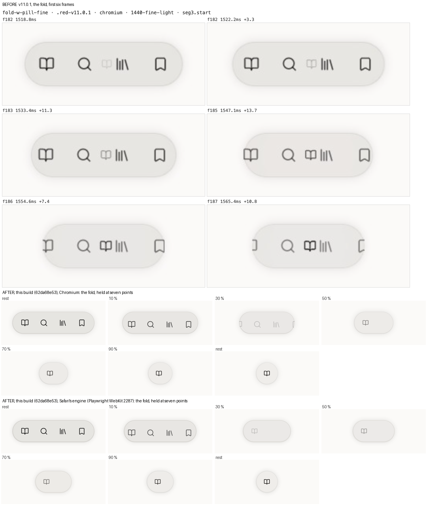
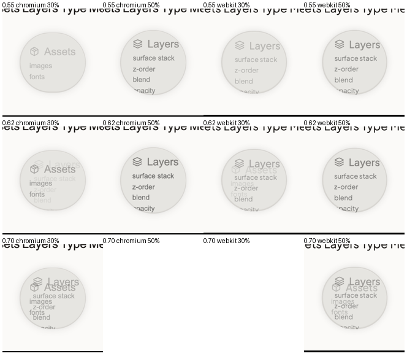

# The dock: one page for the owner

2026-11-15. The dock's new carrier has been built three times, measured in both engines (Chromium and Safari's, through Playwright WebKit; real Safari is still unread), challenged twice, and amended again today. It is not finished: no test passes in both engines with its counter-test read. This page says what you will see when it is, where it stands today, what was cut and why, and seven questions.

The strips are today's build. In each, v11.0.1 is above and the build is below, in Chromium and in Safari's engine, with the change held at seven points.

## What you will see

- **Rounded, always.** The dock is a full stadium at rest, open, and in every frame between, and a one-seat dock is a circle. The ending you saw go "to a square and then to a circle" is one shape narrowing: read in pixels today, the outline stays within three quarters of a pixel of a true stadium all the way through the fold. A folded filter dock that carries words ("Filters · 3") is a pill as wide as its words. One place is not right yet, and it is question 5: in a dock taller than one row, the corner of the content pokes past the curve.
- **Nothing lands in one frame.** Width and height glide together on one spring. The open controls stay where they are and fade under the closing edge, and the folded face fades in after them: out, then in, never one printed over the other. For about two frames between them the dock holds almost nothing. That dip is question 7.
- **It stays a while after you leave.** 6 s, and longer the longer you stayed, up to 12 s. Come back while it is folding and it turns round from wherever it is, keeping its momentum.
- **It does not open by accident.** A page scrolling under a still pointer opens nothing; today that opens a dock in Safari. And a dock you closed with Escape stays closed until the pointer leaves and comes back.
- **A press anywhere else closes it at once**, menus and all. Escape closes an open menu first and the dock second.
- **Whatever the dock opened keeps the dock.** A menu, a list, a popover or a dialog opened from a dock button holds the dock open with nothing for a site to set, and focus goes back to that button when it closes.
- **A layer change is one movement.** The dock resizes on the same clock, the old layer fades in place, and the new one arrives from the side it lives on. Going back mid-change turns it round where it is, with no jump.
- **The controls dock.** One small round dock in a corner for a page's own controls, your "controls button that is a dock, too". On a phone it folds to one seat. It is the same piece for a figure's filters, a canvas's tools and the theme toggle, so no site builds its own. It lingers 3 s, not 6, so a page of figures does not fill with open docks.
- **A page with one control shows that control.** It does not fold to a glyph that costs a press to reveal the one thing behind it.
- **When the icons do not fit on a phone**, the current page's name gives way first, so every icon shows, and only then does the dock scroll. This one is ruled and not built.
- **The reading-progress rim** follows the dock's outline, folded and open, and through the change. Ruled and not built.

## Where it stands

On the third build, every test in both engines: the fold and the unfold pass on the pill, the rounded and card docks, atlas's rail, the layered docks, a held slider, the controls dock at all four corners, and the daraksha, sci-report, fourier and keyframes compositions. 110 of 114 travels pass in Chromium and 109 of 114 in Safari's engine. Turning back during a fold works in every case tried. A press outside closes the dock within a frame or two, and a scroll no longer opens it in either engine.

Cured today, and read in both engines:

- A worded folded face was being squeezed into a circle with its words spilling out. It is now a pill that fits them.
- The one-seat controls dock was 48 by 52 at a mouse pointer. It is a 52 px circle.
- Menus, lists and popovers did not hold the dock: it folded under its own open menu. They hold it now.
- Going back in the middle of a layer change made the old layer jump by up to 9 px and then stall. It does neither now.
- A quick third layer change left the dock unreadable for over a tenth of a second. That is halved.
- A dock closed with Escape reopened on the next pixel of pointer movement. It stays closed.
- A window resize during a fold (which Safari on a phone fires whenever its toolbar hides) snapped the dock shut in one frame. It glides on.
- On a right-to-left page the icons were clipped to a sliver for the whole travel. They show.

Still failing:

- Turning back at the exact middle of a fold, or late in a layer change, leaves the dock nearly empty for 60 to 98 ms. It is the dip of question 7, held longer.
- The current page's seat moving twice in quick succession in a scrolling dock on a phone.
- One seat that vanishes a frame or two early where a pinned seat slides over it.
- An icon added to or removed from an open dock appears and disappears in one frame.
- **Found today:** on a phone in Safari's engine, keyframes's transport dock cannot be opened by touch at all. Every earlier Safari "phone" test was pressing with a mouse. The rule is written (a dock with nothing to tap stays open on a phone) and not built.

Not yet done: a whole pass of every test on today's build (today's changes were read on thirty cells), and the release checks of the versions already shipped.

## What was cut, and why

- **The theme seat parting from the dock with a neck.** Three ways of drawing the neck were built. None reads as one piece of glass, and the last is worst in Safari's engine. In 11.2.0 the theme toggle is a round dock of its own beside the main one; the fusing waits for 12.0.0 and one Safari test that says a neck can be drawn.
- **Names that appear beside an icon and shift the others.** Built twice, the name printed over the next icon and gave a phone nothing, and it made every icon move on every hover.
- **Two docks side by side that move each other.** The controls dock in its corner replaces that arrangement.
- **A "More" button for icons that do not fit.** Which icons hide behind it is a choice each site would have to make, and you asked for one rule.
- **Test limits that could not fail, or could not pass.** Earlier, limits written for a 120 Hz screen. Today, four that passed by construction: a corner test that compared the code's number with itself and never looked at a pixel, an "empty dock" test that counted a layer at 12 % strength as showing, a shadow test that counted one line of CSS, and phone tests driven by a mouse. Each now reads the thing itself.

## Seven questions

Each has a default, and the work goes on with it unless you say otherwise.

1. **The theme toggle.** May 11.2.0 ship it as its own round dock, with the fusing held for 12.0.0 behind a Safari test?
   Default: yes.

2. **Names for the icons.** Should a name show above the icon, as the macOS Dock does, on hover and on a press and hold on a phone, with the dock staying the same size and nothing shifting?
   Default: yes. It comes with the Tooltip work, not with this dock release.

3. **A brush.** A pointer that only crosses the site's dock opens it for the full 6 s. Should a brush keep it open for less? And is 3 s right for a controls dock over a figure?
   Default: 6 s for the site's dock, since your latest word asked for longer; 3 s, growing to 6, for a controls dock.

4. **A figure's controls dock.** When the pointer reaches it, does the whole dock open at once, with no seat unfolding one by one under the pointer?
   Default: yes, the whole dock, at its one size.

5. **A dock taller than one row.** Your "Rounded." makes it a full stadium, and then its content has to be padded in from the ends to stay inside the curve, which makes the dock wider. The other answer is a rounded rectangle for docks of two rows or more. This is today's build, with the selected tab past the glass:

   

   Default: a full stadium, content padded inside it.

6. **The dock's edge and shadow.** The edge is the same rim every glass surface has: three hairlines, one of them a faint white line along the top. The shadow is soft all round with no offset. Your rule on shading reads the white line as a catch-light and that shadow as a glow. Keep them, or cut the white line from all glass and give the shadow a direction?
   Default: keep both for now, and decide the rim for every glass surface at once.

7. **Between two layers: a dip or a dissolve.** Out, then in, is clean, and for about two frames the dock holds almost nothing. A dissolve has no dip, and for about three frames the two layers print over each other, which is how v11.0.1 looked. Top row is out, then in; the next two are dissolves, mild and full:

   

   Default: out, then in.

One thing only you can do: a look at any dock page in real Safari, on a phone if you can. Seats cannot open a headed browser, every Safari reading here is the test engine's, and that engine draws the glass without its blur.

## Added 2026-11-15, after the fifth build was measured

The fifth build passes eight of its tests in both engines, and the work left is small (`MEASURE-5.md`, `RULINGS-5.md`). Today's strips are `fold/strip-fold-5.png`, `fold/strip-swap-5.png` and `fold/crop-many-5.png`. Four things are yours to decide. Each has a default, and the work goes on with it unless you say otherwise.

8. **The current page's name is no longer inside the dock.** Every icon is the same width, the current one included, and the current page is shown by its highlight. On every page change the old named icon moved all the others by 96 px in one frame, and it could not be made to glide in this release. The name shows above the icon on hover and focus instead (question 2). This also replaces the line above about the name giving way on a phone: a dock with too many icons now shows whole icons only and scrolls by whole icons.

   

   Default: yes, icons only, with names above. If you want the name beside the icon, it comes back in 12.0.0, where it can glide.

9. **Icons at nine tenths of their seat, on every site.** You asked for icons twice as big with less padding. On daraksha's dock that came out as a 40 px picture in a 44 px seat, with the bar no taller. The same share becomes the default for every dock, line icons included. Strips at today's size, at three quarters and at nine tenths are owed to you before it ships.
   Default: nine tenths.

10. **A firmer dock.** Measured over a busy ground in dark, the dock's words and icons read at 1.9 to 4.1 where 4.5 is the floor for words. More opacity alone did not fix it on daraksha (two steps only made it greyer). So the plate goes one step more opaque, takes more of the page's own surface colour until the words read, and nothing in a dock is drawn dimmer than the rest to rank it: an inactive tab is as dark as the current one and differs by the highlight. The blur and the shadow do not change. Strips of today's plate, one step, and the first that passes are owed to you.
    Default: the least firm plate that passes.

11. **When a page changes the room it gives an open dock.** A window resize already moves the dock at once, with the window. The same now holds when the page itself narrows or widens the dock's room: the dock follows in that frame and does not glide after it, so it never paints outside its room and never trails a panel being dragged. Everything the dock does itself (open, fold, layers, icons added or removed) still glides.
    Default: follow at once.
