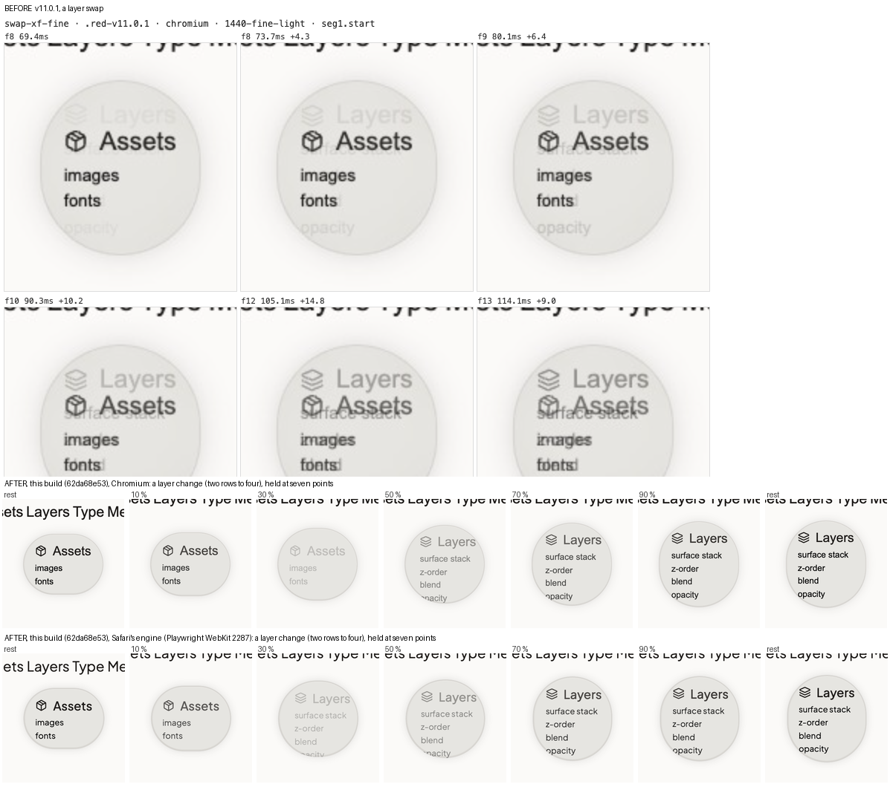
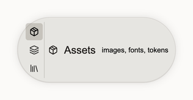
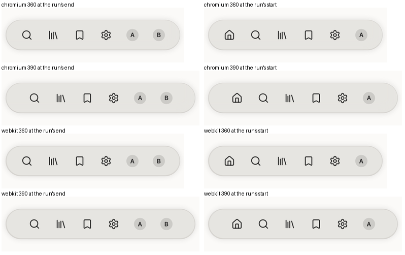
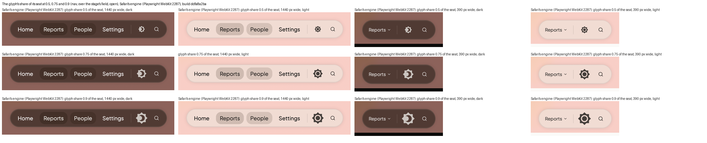

# The dock: one page for the owner

2026-11-15. The dock's new carrier has been built three times, measured in both engines (Chromium and Safari's, through Playwright WebKit; real Safari is still unread), challenged twice, and amended again today. It is not finished: no test passes in both engines with its counter-test read. This page says what you will see when it is, where it stands today, what was cut and why, and seven questions.

The strips are today's build. In each, v11.0.1 is above and the build is below, in Chromium and in Playwright WebKit, which draws the glass without its blur and is not what Safari shows, with the change held at seven points.

## What you will see

- **Rounded, always.** The dock is a full stadium at rest, open, and in every frame between, and a one-seat dock is a circle. The ending you saw go "to a square and then to a circle" is one shape narrowing: read in pixels today, the outline stays within three quarters of a pixel of a true stadium all the way through the fold. A folded filter dock that carries words ("Filters · 3") is a pill as wide as its words. One place is not right yet, and it is question 5: in a dock taller than one row, the corner of the content pokes past the curve.
- **Nothing lands in one frame.** Width and height glide together on one spring. The open controls stay where they are and fade under the closing edge, and the folded face fades in after them: out, then in, never one printed over the other. For about two frames between them the dock holds almost nothing. That dip is question 7.
- **It stays a while after you leave.** 6 s, and longer the longer you stayed, up to 12 s. Come back while it is folding and it turns round from wherever it is, keeping its momentum.
- **It does not open by accident.** A page scrolling under a still pointer opens nothing; today that opens a dock in Safari. And a dock you closed with Escape stays closed until the pointer leaves and comes back.
- **A press anywhere else closes it at once**, menus and all. Escape closes an open menu first and the dock second.
- **Whatever the dock opened keeps the dock.** A menu, a list, a popover or a dialog opened from a dock button holds the dock open with nothing for a site to set, and focus goes back to that button when it closes.
- **A layer change is one movement.** The dock resizes on the same clock, the old layer fades in place, and the new one arrives from the side it lives on. Going back mid-change turns it round where it is, with no jump.
- **The controls dock.** One small round dock in a corner for a page's own controls, your "controls button that is a dock, too". On a phone it folds to one seat. It is the same piece for a figure's filters, a canvas's tools and the theme toggle, so no site builds its own. It lingers 3 s, not 6, so a page of figures does not fill with open docks.
- **A page with one control shows that control.** It does not fold to a glyph that costs a press to reveal the one thing behind it.
- **When the icons do not fit on a phone**, the current page's name gives way first, so every icon shows, and only then does the dock scroll. This one is ruled and not built.
- **The reading-progress rim** follows the dock's outline, folded and open, and through the change. Ruled and not built.

## Where it stands

On the third build, every test in both engines: the fold and the unfold pass on the pill, the rounded and card docks, atlas's rail, the layered docks, a held slider, the controls dock at all four corners, and the daraksha, sci-report, fourier and keyframes compositions. 110 of 114 travels pass in Chromium and 109 of 114 in Playwright WebKit, which draws the glass without its blur. Turning back during a fold works in every case tried. A press outside closes the dock within a frame or two, and a scroll no longer opens it in either engine.

Cured today, and read in both engines:

- A worded folded face was being squeezed into a circle with its words spilling out. It is now a pill that fits them.
- The one-seat controls dock was 48 by 52 at a mouse pointer. It is a 52 px circle.
- Menus, lists and popovers did not hold the dock: it folded under its own open menu. They hold it now.
- Going back in the middle of a layer change made the old layer jump by up to 9 px and then stall. It does neither now.
- A quick third layer change left the dock unreadable for over a tenth of a second. That is halved.
- A dock closed with Escape reopened on the next pixel of pointer movement. It stays closed.
- A window resize during a fold (which Safari on a phone fires whenever its toolbar hides) snapped the dock shut in one frame. It glides on.
- On a right-to-left page the icons were clipped to a sliver for the whole travel. They show.

Still failing:

- Turning back at the exact middle of a fold, or late in a layer change, leaves the dock nearly empty for 60 to 98 ms. It is the dip of question 7, held longer.
- The current page's seat moving twice in quick succession in a scrolling dock on a phone.
- One seat that vanishes a frame or two early where a pinned seat slides over it.
- An icon added to or removed from an open dock appears and disappears in one frame.
- **Found today:** at phone width under touch in Playwright WebKit (without the glass's blur, and not what Safari shows), keyframes's transport dock cannot be opened by touch at all. Every earlier WebKit "phone" test was pressing with a mouse. The rule is written (a dock with nothing to tap stays open on a phone) and not built.

Not yet done: a whole pass of every test on today's build (today's changes were read on thirty cells), and the release checks of the versions already shipped.

## What was cut, and why

- **The theme seat parting from the dock with a neck.** Three ways of drawing the neck were built. None reads as one piece of glass, and the last is worst in Playwright WebKit, which draws the glass without its blur. In 11.2.0 the theme toggle is a round dock of its own beside the main one; the fusing waits for 12.0.0 and one Safari test that says a neck can be drawn.
- **Names that appear beside an icon and shift the others.** Built twice, the name printed over the next icon and gave a phone nothing, and it made every icon move on every hover.
- **Two docks side by side that move each other.** The controls dock in its corner replaces that arrangement.
- **A "More" button for icons that do not fit.** Which icons hide behind it is a choice each site would have to make, and you asked for one rule.
- **Test limits that could not fail, or could not pass.** Earlier, limits written for a 120 Hz screen. Today, four that passed by construction: a corner test that compared the code's number with itself and never looked at a pixel, an "empty dock" test that counted a layer at 12 % strength as showing, a shadow test that counted one line of CSS, and phone tests driven by a mouse. Each now reads the thing itself.

## Seven questions

Each has a default, and the work goes on with it unless you say otherwise.

1. **The theme toggle.** May 11.2.0 ship it as its own round dock, with the fusing held for 12.0.0 behind a Safari test?
   Default: yes.

2. **Names for the icons.** Should a name show above the icon, as the macOS Dock does, on hover and on a press and hold on a phone, with the dock staying the same size and nothing shifting?
   Default: yes. It comes with the Tooltip work, not with this dock release.

3. **A brush.** A pointer that only crosses the site's dock opens it for the full 6 s. Should a brush keep it open for less? And is 3 s right for a controls dock over a figure?
   Default: 6 s for the site's dock, since your latest word asked for longer; 3 s, growing to 6, for a controls dock.

4. **A figure's controls dock.** When the pointer reaches it, does the whole dock open at once, with no seat unfolding one by one under the pointer?
   Default: yes, the whole dock, at its one size.

5. **A dock taller than one row.** Your "Rounded." makes it a full stadium, and then its content has to be padded in from the ends to stay inside the curve, which makes the dock wider. The other answer is a rounded rectangle for docks of two rows or more. This is today's build, with the selected tab past the glass:

   

   Default: a full stadium, content padded inside it.

6. **The dock's edge and shadow.** The edge is the same rim every glass surface has: three hairlines, one of them a faint white line along the top. The shadow is soft all round with no offset. Your rule on shading reads the white line as a catch-light and that shadow as a glow. Keep them, or cut the white line from all glass and give the shadow a direction?
   Default: keep both for now, and decide the rim for every glass surface at once.

7. **Between two layers: a dip or a dissolve.** Out, then in, is clean, and for about two frames the dock holds almost nothing. A dissolve has no dip, and for about three frames the two layers print over each other, which is how v11.0.1 looked. Top row is out, then in; the next two are dissolves, mild and full:

   

   Default: out, then in.

One thing only you can do: a look at any dock page in real Safari, on a phone if you can. Seats cannot open a headed browser, every Safari reading here is the test engine's, and that engine draws the glass without its blur.

## Added 2026-11-15, after the fifth build was measured

The fifth build passes eight of its tests in both engines, and the work left is small (`MEASURE-5.md`, `RULINGS-5.md`). Today's strips are `fold/strip-fold-5.png`, `fold/strip-swap-5.png` and `fold/crop-many-5.png`. Four things are yours to decide. Each has a default, and the work goes on with it unless you say otherwise.

8. **The current page's name is no longer inside the dock.** Every icon is the same width, the current one included, and the current page is shown by its highlight. On every page change the old named icon moved all the others by 96 px in one frame, and it could not be made to glide in this release. The name shows above the icon on hover and focus instead (question 2). This also replaces the line above about the name giving way on a phone: a dock with too many icons now shows whole icons only and scrolls by whole icons.

   

   Default: yes, icons only, with names above. If you want the name beside the icon, it comes back in 12.0.0, where it can glide.

9. **Icons at nine tenths of their seat, on every site.** You asked for icons twice as big with less padding. On daraksha's dock that came out as a 40 px picture in a 44 px seat, with the bar no taller. The same share becomes the default for every dock, line icons included. Strips at today's size, at three quarters and at nine tenths are owed to you before it ships.
   Default: nine tenths.

10. **A firmer dock.** Measured over a busy ground in dark, the dock's words and icons read at 1.9 to 4.1 where 4.5 is the floor for words. More opacity alone did not fix it on daraksha (two steps only made it greyer). So the plate goes one step more opaque, takes more of the page's own surface colour until the words read, and nothing in a dock is drawn dimmer than the rest to rank it: an inactive tab is as dark as the current one and differs by the highlight. The blur and the shadow do not change. Strips of today's plate, one step, and the first that passes are owed to you.
    Default: the least firm plate that passes.

11. **When a page changes the room it gives an open dock.** A window resize already moves the dock at once, with the window. The same now holds when the page itself narrows or widens the dock's room: the dock follows in that frame and does not glide after it, so it never paints outside its room and never trails a panel being dragged. Everything the dock does itself (open, fold, layers, icons added or removed) still glides.
    Default: follow at once.

## Added 2026-11-16, after the sixth build was measured

The sixth build passes eleven of its fourteen tests in both engines (`MEASURE-6.md`, `RULINGS-6.md`). The three that fail are small and each has a cure written. Five things are new and yours to decide. Each has a default, and the work goes on with it unless you say otherwise.

One correction first, to question 10. The sixth build made the dock about two thirds solid. That was firmer than it needed to be: the words were still drawn dim when the firmness was chosen. The next build draws the words at full strength first and then takes the least firm plate that reads. You will get one strip with five firmnesses side by side.

12. **Delete what no site uses, now.** Eleven apps were read. The dock ships 21 named parts that none of them uses: a background toggle, a search slot and its helper, and some options on the layer group and the divider. The redesign adds 14 names, so unless these go the dock ends up with more to learn than before, which is the opposite of what you asked. Deleting them in 11.2.0 breaks none of your sites. The alternative is to mark them as going and delete them in 12.0.0.
    Default: delete them in 11.2.0.

13. **A page name on a phone.** Names now show above an icon on hover. A phone has no hover, so today a phone shows no name at all. A press and hold will show it (question 2). Should the name of the page you just chose also show above its icon for a moment after you tap?
    Default: no. Press and hold only, so nothing extra moves on every tap.

14. **A dock that sits in a row with other things** (every figure's dock in atlas). Today, when it opens it pushes its neighbour 76 to 82 px, which is most likely the shifting you saw on hover. It can open over its row and move nothing, or the row can keep an empty space the size of the open dock at all times.
    Default: it opens over its row, growing away from the edge it is pinned to. Nothing beside it moves.

15. **A dock with one button that always shows** (Play on keyframes). Today the dock opens around its centre, so Play slides 38 to 109 px out from under your pointer. If Play stays put, the dock opens to one side and is off-centre while it is open.
    Default: the button stays under the pointer and the dock opens away from it.

16. **More icons than fit on a phone.** The dock shows whole icons only and scrolls sideways (question 8). Nothing tells you more icons lie to the side. A half icon peeking at the edge would tell you, and it is the sliver that was removed.
    Default: no cue. A site with that many icons shows a menu on a phone instead.

17. **Big icons beside words.** At nine tenths (question 9) an icon in a dock of worded tabs is much larger than the words next to it. This is the strip: top row today's size, bottom row nine tenths. The search icon does not grow in it because the demo sized it by hand, which is being fixed. The two right-hand columns in the Chromium strip have their dark and light labels swapped and will be shot again.

    

    Default: one share for every dock, nine tenths, words or not.

## Added 2026-11-16: the sixth rulings' questions

Questions 10 and 12 to 18, as amended by the fold, are at the end of `RULINGS-6.md` (each with its default and the strip that shows it). The defaults stand until you answer; the strips that show each are made by the seventh pass.

## Added 2026-11-22 and 2026-11-23, after the ninth build was measured

The ninth build is the eighth with this round's rulings built in. It was measured on one build, in Chromium, where the glass's blur can be judged, and in Playwright WebKit 2287, the other browser we can run here, which draws the glass without its blur and is not what Safari shows, so your own look in Safari settles that. The measure stopped on 2026-11-22 when the Mac's kernel memory reached the point where our test runs wait for a restart, and it was finished after the restart on 2026-11-23: every test in both browsers, the older releases' tests in all four of their set-ups, the word-contrast cells, and the faults we plant to show each test can fail. It isn't ready to become 11.2.0. These stand in the way:

- **The dock's code is 439 lines over its budget**: 5,180 lines against 11.1.0's 4,741. Nothing has been cut. Even with every block on the list removed, behaviours included, it would still be about 90 lines over; the list and what each block does are in `MEASURE-9.md`. Your apps could delete 425 lines of their own once 11.2.0 lands (question 22).
- **A page that uses the dock loads 299 bytes more than on 11.1.0** (104,596 bytes compressed against 104,297), where the budget is no more than 11.1.0. Against 11.0.2 it is 1,965 bytes more (102,631).
- **Opening a dock still costs a few more layout passes than allowed** in 10 of 32 first frames, and three times a figure dock forces one more in the frames after. Landing a fold or an open costs nothing extra, and a page of 18 docks forces one layout in its first frame, within its bound.
- **One of 11.0.2's own tests fails, in both browsers.** In 11.0.2 a moving dock's current button shows the page behind it through its own small glass. This build took that away when it removed the segmented control's second channel inside the dock, and the rule that removed it and the rule that no published fix may be lost disagree. It needs a decision.
- **Three more of the older releases' tests that 11.1.0 passes fail here**: a cockpit dock at phone width paints a sliver of a button past its round end while its row scrolls (both browsers), and a dock whose input layer is taller than one row rests with a corner 5 px short of round under touch (both browsers).
- **Some buttons still jump instead of gliding.** When a word button's label gets shorter, the button beside it jumps about 106 px in one frame. When a button is added or removed, two buttons overlap by about 3.5 px while the row makes room (16 px with reduced motion), and in one change of the dock's regions a button jumps 15 px. In WebKit, when one face of the dock gives way to another, the leaving face moves 0.55 to 1.9 px in its first frame on six of the swaps, where it should hold still; and a wide dock at phone width starts its fold 71 to 78 ms after the tap, where 34 is allowed.
- **A few names and highlights read under the floors.** In dark on the warm figure page, dials's selected 5Y and Lin read 4.48 and 4.36 to 1, under the 4.5 floor for words and under today's 7.69 and 7.56. In light, the action row's highlight on Format stands 1.196 to 1 off the dock, where 1.2 is needed. The loose control's current fill stands 1.27 off the dock in dark, under today's 1.32 (1.25 against 1.27 in WebKit).
- **A few docks are not quite round at the ends**: a crossfading dock's corner is 13 px short of a capsule, a dock with one tall row 4 px short, and a vertical dock folds 3 px off a circle.
- **atlas's figure dock in the head row** works as atlas asked when the folded dock shows its icon directly: none of the title is covered, and nothing moves when it opens. With a 44 px handle around the icon, as atlas's figure docks have today, it folds 74 px wide instead of 52 and covers part of the title.
- **Most of the faults we plant to show a test can fail are caught**, in every browser they are meant for. Four are not: rounding the inner corners where the dock's regions meet changes pixels and no test notices; removing the dock's memory of how its row fits changes nothing a test reads; and two small unit tests miss a fault their browser tests catch (when a finger's lift starts the pause, and the current-page mark's glide).

In WebKit the morning's frames came 17 ms apart instead of the 10 they came at before, so a test that reads the first frame after a tap read a little later there. The WebKit tests that failed were read again at 10 ms: the ones about a missing face for one frame and the reduced-motion folds pass, and the ones above stay.

On the eighth build two things read badly, and this build answers both. Dials's selected range was hard to pick out, 1.07 to 1 off the dock, because a segmented control drew a second, darker channel inside the dock; that channel is gone, and the selected choice is drawn like any selected dock button (1.25 to 1 off the dock in light, 1.37 in dark). A hovered Home looked like a second current page; the hover is now fainter than the current page's highlight in both themes.

Your questions with strips from this build. Each has a default, and the work goes on with it unless you say otherwise.

3. **How long a dock stays after you leave.** 6 s for a site's dock whatever the length of the visit (6,004 to 6,012 ms read), and 3 s for a controls dock (3,026 ms). The pause that grew with the visit is gone.

    Default: the fixed pauses.

5. **A folded card or rounded dock.** Both fold to a circle, 56 px across with a 28 px corner, and keep their corners open (24 px for the card, 16 for the rounded dock). Nothing is scaled while they move, so the corner is one shape in every frame.

    

    Default: a circle for a folded card or rounded dock; 11.1.0's corners on a dock taller than one row.

10. **A firmer dock.** In dark the dock takes the third of five steps. On the warm figure page it now stands 1.44 to 1 off the page, where today's barely stands off it (1.01), and the page still shows through. On the near-black grid page about as much of the grid shows through it as through the light dock on the white grid. At that step the dark dock blurs 11.2 px, where the light dock and every card blur 16. Light takes the first step: 1.30 to 1 off the warm page (today's 1.20), and 1.31 on daraksha's ground (today's 1.21). The rule that would pick the dark step from the readings meets no step on every dock: at the third, the round dock lets a little more of the dark grid through than the light dock lets of the white one (0.124 folded and 0.147 open, against 0.122).

    

    Also `fold/strip-q10-field-9m.chromium.png` and `fold/strip-q10-daraksha-9m.chromium.png`.
    Default: the third of five in dark, with its blur; the first in light.

12. **Delete what no site uses, now.** 78 names a site can use against 11.1.0's 80: 15 added and 17 deleted, the dock's search helper among them.

    

    Default: delete them in 11.2.0.

14. **A dock that sits in a row with other things.** On this build atlas's figure dock pushes its legend 36 px when it opens and covers none of it. The overlay that would keep the row still is not built; on the eighth build it moved the legend 27 px and covered 1,872 px² of it, its link included. Atlas has since chosen the head row for its figure docks, where the open dock covers none of the legend, its link or the plot, and nothing moves.

    

    Default: no change in 11.2.0.

18. **How a hovered icon differs from the current page's.** The current page's highlight is 10 % of the dock's text colour. The hover is 6.5 % in light and 5 % in dark: in light it stands 1.08 to 1 from the current highlight and 1.15 off the dock; in dark 1.14 and 1.13. In light 5 % would stand 1.11 from both, but on one dock it stood under 1.1 off the dock, so light takes 6.5 %. The strip shows 5, 6.5, 8 and 10 % in both themes.

    

    Default: as built; the separation is yours to judge.

19. **A dialog opened from the dock.** A press on the dimmed page closes the dialog, and the dock stays open for its usual pause, folding and landing 6.4 s later. A press outside a menu closes the menu and the dock together.

    

    Also `fold/strip-q19-9m.webkit.png`, in headless WebKit, without the glass's blur.

    Default: yes.

20. **The controls dock on a desktop.** With four controls it rests folded at 1440 and at 390, opens under the pointer, and folds again 3.1 s after the pointer leaves. With one control it is that control.

    

    Also `fold/strip-q20-9m.webkit.png`, in headless WebKit, without the glass's blur.

    Default: yes, with icons at half the button.

21. **The selected tab in dark.** On the warm figure page the selected Reports reads 4.26 to 1 on its highlight, under the 4.5 floor for words but above today's 3.26; dials's selected 5Y reads 4.49 in this frame and 4.48 in the word-contrast cells, under the floor and under today's 7.69, so it stands in the way of the release. On the dark grid page Reports reads 10.33 (today's 9.62). The highlights stand 1.29 to 1.37 off the dock.

    

    Default: keep the dock glass and every name readable; where a selected name still can't reach the floor at the third step, as here on the warm page, the highlight is the faintest that still reads as selected, and those docks are named.

22. **The dock's code.** It is 5,180 lines against 11.1.0's 4,741, 439 more. The list of what could still go is in `MEASURE-9.md`: about 33 lines rewritten shorter with nothing you'd see, and the rest each a behaviour a ruling or a site asked for (nothing changing in a single frame, daraksha's fission seat, 11.1.0's long press, and others). With all of it removed the dock would still be about 92 lines over. Your apps could delete 425 lines of their own with 11.2.0 (their holds, folds and the controls seat), which would leave the two together 14 lines over 11.1.0.

    Default: keep every behaviour. The release waits until the count is met, or until you name what to drop, or let the apps' deletions count against the dock's growth.
