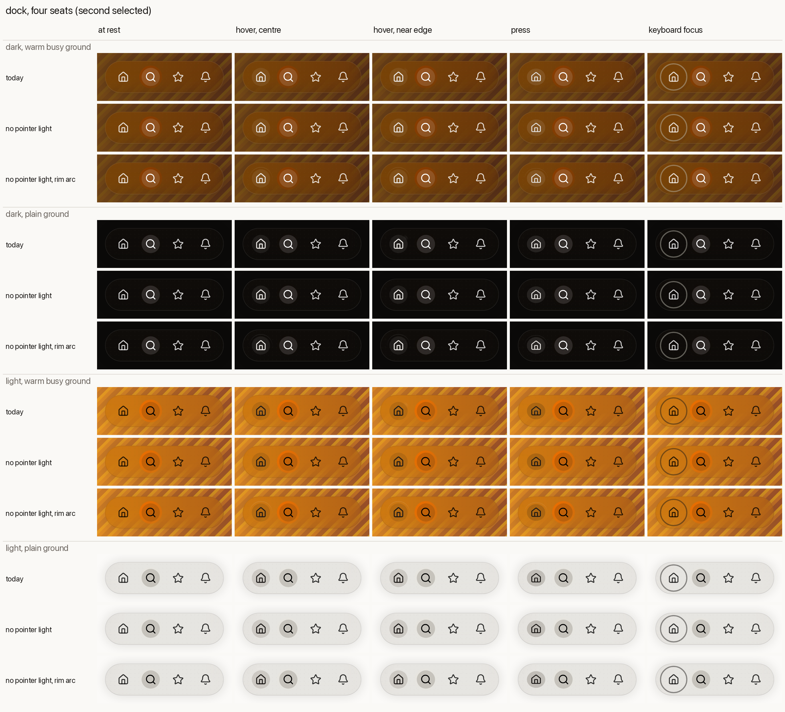

# What you have to choose

Mike, these are the choices that wait on you today, gathered from three places: the lens, fission and fusion study (its first eight passes), the dock redesign's open questions, and the questions still open from the earlier design studies and the 19 November notes. Where one choice was asked in two places it appears once. They run in the order of how much work each one holds up.

Each choice gives the question, what glass-ui does now, the options as A, B and C, what the work assumes until you answer and why, what it costs, and whether a screen can show it or only your iPhone in Safari can. Where a page or a strip already shows it, the link is there. The file and line behind every "today" and every option is in the appendix at the end, by choice number.

## Before you look

- The study's pages (`../pages/`) are built for your iPhone in Safari, and none has been sent to you yet. None has been opened in a browser either: every browser run before the reboot was refused at the kernel memory line. Each page's first line says what to send back.
- The dock strips are Chromium, which draws the blur. The test build of Safari's engine we can run here draws no blur, so where blur, frost or frame rate decide, only Safari on your phone settles it.
- Two pages are not asked of you. The material fits page (`../pages/R3.html`) is held, since your low-blur order of 11 November sets the blur. The split-and-join page (`../pages/R4.html`) is withdrawn, since no split ships on frosted glass.
- Every decision in the study is provisional until your readings come back. Nothing here has been built into a release.

## The order at a glance

| # | Choice | What waits on it | Judge on | See it |
|---|---|---|---|---|
| 1 | The dock's size | 11.2.0 itself | no screen (a count) | — |
| 2 | Unused dock parts and the search helper | 11.2.0's public names | no screen | dock strip |
| 3 | The dark dock's firmness and blur | 11.2.0's tag | iPhone, Safari | dock strips |
| 4 | Springs the phone runs off the page's thread | every 11.3.0 motion | iPhone, Safari | Four Ways to Settle |
| 5 | The hover plate | the hover on every control; the selection mark's colour | screen | motion study strip |
| 6 | The chrome plate from 12.0.0 | 12.0.0's material; every word on chrome | screen | Glass Word Legibility |
| 7 | The edge | every glass surface's rim | screen | Glass Word Legibility, foot |
| 8 | Reduce Motion: a fade or an instant change | every part's reduced form | screen, Reduce Motion on | Glass Selection Mark, strip 4 |
| 9 | The press: a shrink or a tone | every control's press; 12.0.0's deletions | screen | motion study build |
| 10 | A menu growing out of its button | menus, selects, popovers | iPhone for the frost; screen for shape | Glass Bud Shapes; Menu Opening Springs |
| 11 | How things leave | every popup's exit | screen, beside Safari's menu | Menus, Sheets and Dialogs, 1 |
| 12 | The veil under a dialog | every centred dialog | iPhone, Safari | Menus, Sheets and Dialogs, 4 |
| 13 | Sheets you drag | every sheet with detents | iPhone | Menus, Sheets and Dialogs, 3 |
| 14 | A finger sliding across an open menu | short menus on phones | iPhone | Menus, Sheets and Dialogs, 2 |
| 15 | The selection mark: does it lift | tabs, segments, dock seats | screen; iPhone for the drag | Glass Selection Mark, 1 |
| 16 | The mark: does it stretch | the same | screen | Glass Selection Mark, 2 |
| 17 | The mark: equal or content widths | every segmented strip | screen | Glass Selection Mark, 3 |
| 18 | The mark under the arrow keys | keyboard on every strip | screen | Glass Selection Mark, 4 |
| 19 | How motions are counted | every selection and every fold | no screen | — |
| 20 | One more edge on the chosen option | the mark in dark and on icon runs | screen, Light then Dark | Glass Mark Hosts, 2 |
| 21 | A dock run that scrolls | dock seats on a phone | iPhone | Glass Mark Hosts, 1 |
| 22 | A stepped slider | stepped sliders and levels | screen; iPhone for the drag | Glass Mark Hosts, 3 |
| 23 | The held slider and the magnifier | every slider | screen | Glass Selection Mark, 1 (B) |
| 24 | The theme seat parting and joining | the theme toggle, 12.0.0 | iPhone, Safari | Glass Split and Fuse, 1 |
| 25 | The fold: faster, less fade | every dock fold, 12.0.0 | screen; iPhone for a busy page | Glass Split and Fuse, 2 |
| 26 | The scrolling parts | fade edges, the collapsing bar, the progress rim | iPhone | Scroll Under Load |
| 27 | How glass arrives | entrances in 11.x; the toast | iPhone, Safari | How Glass Arrives |
| 28 | Blur on hover surfaces | hover cards, popovers, menus, selects | iPhone, Safari | — |
| 29 | Reduce Transparency in Safari | readers who turn it on | no screen | — |
| 30 | The dark Switch | the Switch, and one thumb tone for three parts | screen | — |
| 31 | The pager dots | carousels | screen | your frame of 12 Nov |
| 32 | The accent rim's weight | atlas's cards | screen | — |
| 33 | The code font's fetch | the demo site's code pages | screen, slow network | — |
| 34 | Five additions nobody asked for | nothing until kept | no screen | — |
| 35 | A dock that sits in a row | in-flow docks | screen | dock strip |
| 36–45 | Ten dock questions whose defaults are being built | the dock's details | screen | dock strips |
| 46–48 | Earlier studies still open (motion and hover, underline, depth) | their parts | screen; one Safari look | their strips |
| 49–51 | Earlier studies settled (slider, highlight dot, demo site, dock's first questions) | nothing | — | their strips |

---

## Holding 11.2.0

### 1. The dock's size

**The question.** The redesigned dock is larger than 11.1.0 in lines and in bytes: does the release wait, drop behaviours, or count the apps' deletions against the growth?

**Today (11.1.0).** 4,741 code lines in the dock's folder; a page that uses the dock loads 104,297 bytes compressed.

**The build.** 5,180 lines, 439 over; 104,596 bytes, 299 over (1,965 over 11.0.2).

- **A.** Keep every behaviour, and the release waits until the count is met. With every block on the list removed, behaviours included, the dock would still be about 92 lines over, so A also needs cuts nobody has found yet.
- **B.** Name what to drop. About 33 lines can be rewritten shorter with nothing you would see. The rest are each a behaviour that you or a site asked for: nothing changing in a single frame, daraksha's theme seat, 11.1.0's long press, and others.
- **C.** Count the apps' deletions. With 11.2.0 the apps could delete 425 lines of their own (their holds, folds and controls seat), which leaves the two together 14 lines over 11.1.0.

**Assumed until you answer.** A, since each block answers a request. As things stand, A holds 11.2.0 with no end in sight.

**What it costs.** A: the release. B: the behaviours you name. C: a dock 439 lines larger than 11.1.0, paid for in the apps.

**Judge on.** No screen; it is a count. The list of blocks, each with its lines and who asked, is in the dock's ninth measure.

### 2. Unused dock parts, and the search helper

**The question.** Do the 17 dock parts that no site uses go in 11.2.0, the dock's search helper among them?

**Today (11.1.0).** 80 names a site can use, among them the search helper and the dock's search slot.

- **A.** Delete all 17 in 11.2.0: 78 names, 15 added and 17 deleted. atlas's search stays a command dialog, ranked by atlas's own ranker from 11.1.2.
- **B.** Keep the helper through 11.x, with atlas's two ranking options on it (keep a ranked source's order and drop nothing, or better tiers in the matcher).
- **C.** Mark all 17 as going and delete them in 12.0.0, where removals usually go.

**Assumed until you answer.** A. No released site uses any of them. atlas, the one site that once wanted the helper, now calls neither the helper nor the slot, and its own plan recommends retiring the helper.

**What it costs.** B keeps the helper's code inside choice 1's count. C keeps all 17 until 12.0.0. A breaks the usual rule that a removal waits for a major.

**Judge on.** No screen.

### 3. The dark dock's firmness and blur

**The question.** How firm is the dock in dark in 11.2.0, given that the one setting that firms it also lowers its blur?

**Today (11.1.x).** The dock is at full glass in both modes and blurs 16 px like every glass surface. In dark it barely stands off a warm page (1.01 to 1).

- **A.** Dark takes the third of five steps: it stands 1.44 to 1 off the warm figure page, and on a near-black grid about as much of the grid shows through it as through the light dock on a white one. At that step the dark dock blurs 11.2 px. Light takes one step more ink: 1.30 to 1 off a warm page (today 1.20), 1.31 on daraksha's ground (today 1.21), and a shade greyer on plain white.
- **B.** The fourth step. It evens the small round dock, which at the third still lets a little more of a dark pattern through than the light dock does (0.124 folded and 0.147 open, against 0.122), but at the fourth every other dock hides the pattern entirely: the near-solid dock you turned down.
**Assumed until you answer.** A.

**What it costs.** A gives the dark dock a second blur value, against your rule of one blur on every glass surface. No design yet firms the dock in 11.2.0 without lowering its blur; from 12.0.0 the question goes away, since under your low-blur order the dock samples nothing (choice 6).

**Judge on.** Your iPhone, in Safari, before the tag. The strips are Chromium.

Also: `../../../BL/design/dock/wi8/fold/strip-q10-field-9m.chromium.png`, `../../../BL/design/dock/wi8/fold/strip-q10-daraksha-9m.chromium.png`.

---

## Under every motion and surface

### 4. Springs the phone runs off the page's thread

**The question.** Should every spring move to a single curve that Safari runs on the GPU in every version, at the cost of each curve's shape moving by at most 2.44 % of its travel (3.67 % for the one that bounces)?

**Today.** Every spring is a 48-step curve. Safari hands such a curve to the GPU only from 27.3, so in Safari 27.2, every iOS 26 Safari and Home Assistant's app, every spring glass-ui plays runs on the page's thread and can stall when the page is busy. A mark sent to a second tab while it is still gliding stops dead and starts again. The six curves are 1,637 bytes in every site's stylesheet.

- **A.** Keep the 48-step curves: exact, and on the GPU from 27.3.
- **B.** One single curve per spring for state changes (within 2.44 %; the bounciest spring within 3.67 %, refitted so it keeps its own bounce and no more: `cubic-bezier(0.215, 0, 0.059, 1.288)`, where the first fit bounced 5.61 %), and a small player for anything that carries a finger's speed, which hands the speed on when it turns round.

**Assumed until you answer.** B, provisional until the phone shows which curves stutter on a busy page.

**What it costs.** B frees 1,487 bytes of stylesheet at every site and adds 655 bytes of script for the player. daraksha's reader route has about 45 bytes to spare, so there the player loads on the first touch of a seat. The motion precepts are reworded to say which properties and curves the GPU takes. A separate curve with a 22 % overshoot, on chips, buttons' rotation and the slider, is put to you beside it, since overshoot on a control is your rule.

**Judge on.** Your iPhone in Safari only: which dots stutter with Busy page on, then with Low Power Mode on, with your iPhone model and iOS version. How many readers will be on 27.3 when 11.3.0 ships is unknown.

**See it.** Four Ways to Settle (`../pages/R2.html`); Scroll Under Load (`../pages/P2-scroll.html`), where B, D and F already ride the single curve; Touch Event Rate (`../pages/R6.html`). Nearly every "runs on the GPU" claim in choices 10 to 25 assumes B.

### 5. The hover plate

**The question.** When you point at a control, what does its plate look like: the faint grey first built, a full-strength plate in the control's own colour with the icon taking that colour, or that with a soft shape?

**Today.** The first build's plate is a 5 % grey fill that can barely be seen. Your frame was Google Chat's pin on a peach, soft-cornered plate.

- **a.** The plate as first built.
- **b.** The plate at full strength in the seat's own colour, the icon taking that colour.
- **c.** b with a soft shape. A shape costs no markup, but each destination needs its own drawn.

**Assumed until you answer.** Nothing: this one has no default, and the plate's sites have waited on it since 12 November.

**What it costs.** c needs a shape drawn per destination. b and c make the hover strong, and the dock has just made its hover fainter than the current page's highlight because a hovered Home read as a second current page (choice 42). The selection mark takes the plate's "on" strength as its fill, so this pick also sets the mark's colour.

**Judge on.** A screen.

### 6. The chrome plate from 12.0.0

**The question.** From 12.0.0 the dock, menus, sheets and dialogs sample nothing behind them, so their fill alone carries every word: which words must it hold?

**Today.** Glass blurs 10 to 22 px over a thin tint (16 on the dock, 22 on overlays). Over black in light a word on the dock reads 1.17 to 1, and over white in dark 1.09 to 1. The dock darkens with the page behind it by sampling it, which earns at most two steps of ink, far too few in dark.

- **A.** The firmest panel: the grey second line stays readable over anything. In light 90 % card colour, in dark 87 %; about a tenth of a photograph's detail shows through.
- **B.** One ink: every word on chrome is drawn in full ink, and the plate is lighter (55 % in light, 74 % in dark; about half the photograph shows in light). On a highlight the chosen word then falls to 3.57 to 1 over black in light, so B needs 65 % and 84 % to keep it.
- **C.** For icons: 44 % and 62 %. Small words fall under 4.5 to 1 over a bright photograph or the aurora in dark.

**Assumed until you answer.** A is what the material floor already drafted solves for. The study names no default.

**What it costs.** Any letter retires the dock's darkening that follows the page: 2,860 bytes of script at every dock site and 187 of stylesheet. In dark, A and B are firmer than the dark dock you turned down (two thirds solid). Even under A, the unchosen word on a tab strip over black in light reads 4.02 to 1.

**Judge on.** A screen: no panel on this page blurs.

**See it.** Glass Word Legibility (`../pages/R3b.html`): per background, the letters whose small words you cannot read, in Light and in Dark; then the letter you would ship for each mode.

### 7. The edge

**The question.** What edge does a glass surface carry: today's three hairlines, one hairline in light only, or none?

**Today.** A hairline of the text colour at 4 to 8 % (8 % on the dock), and on top of it a 10 % white line along the top and inner shade lines below. Your shading rule reads the white line as a catch-light.

- **A.** Keep all three, and decide the rim for every surface at once (the dock page's default of 15 November).
- **B.** One hairline in light, drawn as the border, never a shadow; none in dark, where the plate stands off the page by its own colour. The white line and the shade lines go. Under more contrast the edge shows in both modes.
- **C.** No edge in either mode.

**Assumed until you answer.** B is the study's proposal; A is what ships.

**What it costs.** B removes 213 bytes at every site. atlas reads the inner lines in its own shadow lists and daraksha zeroes them, so both are told.

**Judge on.** A screen. Your words to weigh it against: "crisp edge, no halo", and "some docks have this distinct black border, which is totally wrong."

**See it.** The foot of Glass Word Legibility (`../pages/R3b.html`): "with edge" or "without", for each mode.

### 8. Reduce Motion: a fade, or an instant change

**The question.** With Reduce Motion on, does every change become a short fade, or does a choice change in one frame?

**Today (11.1.0).** The library's fallback sets every transition to zero under Reduce Motion, so the Switch's thumb, the tabs' indicator ("under reduced motion the indicator snaps"), the collapsing bar and the progress bar land in one frame. 11.1.1, not yet released, makes its popups' exits a fade of up to 200 ms (ruled for 11.1.1, and yours to reverse).

- **A.** A fade everywhere: the mark fades out where it was and in where it goes (100 ms each way); the Switch's thumb dips out, lands hidden, and returns (200 ms); a quantity's length tweens over 150 ms or less, so it never hides. For the dock's fold, the plate dims for 100 ms, lands hidden and returns over 100 ms.
- **B.** An instant change, as the 12.0.0 restraint plan writes it: "a commit is an instant state change", the tone staying. For the dock's fold, the shape lands in one frame and the content fades over 100 ms.

**Assumed until you answer.** A, by your rule that nothing changes instantly.

**What it costs.** Each fade is a rule of under 100 bytes, enrolled past the library's fallback. Home Assistant asks for 120 to 150 ms.

**Judge on.** A screen, with Reduce Motion on.

**See it.** Glass Selection Mark (`../pages/P5-mark.html`), strip 4, letter C, is the mark's reduced form.

### 9. The press: a shrink, or a tone

**The question.** Does a pressed button or icon shrink, or does it answer by its tone alone?

**Today.** The Button squashes to about 1.03 by 0.92 when pressed; a dock seat shrinks to 0.96; the Switch's face squishes to 0.96. In July you retired the press indent; on 12 November you asked that keyframes' edit icon "shrink like a click".

- **A.** The shrink as built in the motion study: every button and icon shrinks evenly to 0.97 with its plate at full strength, about a tenth of a second down and back, no bounce. Cards, rows and large surfaces answer by colour alone.
- **B.** Tone only: the press deepens the hover fill a little, and nothing scales. The 12.0.0 restraint plan deletes every press scale this way, and the lens study proposes it for tabs, dock seats and the Switch.

**Assumed until you answer.** The motion study's default is A; the 12.0.0 plan and the lens study assume B. 12.0.0's press deletion and two of keyframes' asks wait on your answer.

**What it costs.** A keeps one document listener and the press-scale tokens; B deletes them. The 12.0.0 plan also asks whether the hover's lift goes with the press (its default: yes).

**Judge on.** A screen.

---

## Menus, sheets and dialogs

### 10. A menu growing out of its button

**The question.** How does a menu, select or popover open from its button: today's grow, through rounded windows, or a fade at its own size?

**Today.** A menu grows from its button by a rounded clip with its rows at full strength from the first frame, by your order of 5 November ("every height and width animated, no needless fade"), on a spring that is 98 % of the way there at 314 ms.

- **C.** Today's grow, started from the button. It keeps your 5 November order and stays within the two-animations-per-press ceiling, but the clip runs on the page's thread in Safari and breaks your later "transform and opacity only".
- **D.** Three windows of the panel's own shape slide open. It keeps both of those rules but adds two wrappers for a motion (the ceiling allows none) and runs four or five animations per press; its edge and shadow land only at rest.
- **E.** The panel fades in at its own size from 96 %. It is within the ceiling if the button's held fill waits for the panel to land, and it is done by 205 ms, inside Home Assistant's "done by 200 ms". It reverses your "no needless fade", and it never takes the button's shape, which value.js, gaggle and Home Assistant asked for.

**Assumed until you answer.** Nothing is chosen: today's grow ships until you pick, since a study's rule never cuts your order.

Two smaller proposals ride with it. The spring follows the letter: E on the quick, still spring; C and D on the slower one, because your weight rule gives a box that grows about 0.3 s. And a menu opened from a button on a plate (a dock seat) is born outside the plate and never covers it, so no two translucent plates stack; it costs under 100 bytes. No neighbour moves aside.

**What it costs.** E adds 190 bytes and D 268, each against the 346-byte clip it replaces. On today's curves every letter runs on the page's thread; on choice 4's single curves D and E move to the GPU and C does not.

**Judge on.** Corners and frost in 11.x only on your iPhone in Safari, with Frost on. Shape and timing on a screen.

**See it.** Glass Bud Shapes (`../pages/P4-bud.html`): which letters lose their round corners or show a square or darker patch, which stutter on a busy page, then the one letter, A to E, that best grows out of its button. Menu Opening Springs (`../pages/R5.html`): which of four springs opens most like Safari's own menu (C and D overshoot, which your no-overshoot rule refuses unless you amend it).

### 11. How things leave

**The question.** Does everything that leaves by fading leave in 120 ms, by its opacity alone?

**Today (11.1.1).** A menu or select takes about 220 ms with its clip running back; a popover, hover card or toast 250 ms with a few pixels of slide; a dialog about 180 ms; a tooltip 120.

- **A.** As 11.1.1.
- **B.** Every popup leaves by a 120 ms fade: no clip running back, no slide, one clock for all. Sheets leave the way they came.

**Assumed until you answer.** B. The motion study's question 4, defaulted on 12 November, asked the same: "a thing that appeared leaves in about half the time with less travel."

**What it costs.** One clock replaces each kind's own; nothing added beyond it. If you read your 5 November order as covering the close as well, the menu's clip stays on the way out.

**Judge on.** A screen, best beside Safari's own menu on the phone.

**See it.** Menus, Sheets and Dialogs (`../pages/P8-present.html`), section 1: A today, B the fade.

### 12. The veil under a dialog

**The question.** A centred dialog frosts the whole page and then frosts again on its own plate: keep both, keep one, or keep neither?

**Today.** Two live blurs per dialog, about 3.76 million device pixels on a phone; Home Assistant's app pays for both.

- **A.** Both, as today.
- **B.** The veil is the one blur and the dialog's plate is a tint over it (about 2.96 million device pixels).
- **C.** A dim with no blur and a near-solid plate. This is what 12.0.0 ships under your low-blur order, unless the veil is pointed at a blur of its own.

**Assumed until you answer.** B in 11.3.0; 12.0.0 is yours.

**What it costs.** B adds 115 bytes. Against it stand Home Assistant's "these modals should be more glassy" (15 November) and your low-blur order (11 November).

**Judge on.** Your iPhone, in Safari: the blur decides it.

**See it.** Menus, Sheets and Dialogs, section 4, in Light and in Dark.

### 13. Sheets you drag

**The question.** Should a sheet with detents become a native scroller, so iOS does the drag, the fling and the rubber band?

**Today.** The sheet's script resizes it every frame on a spring. On gaggle the side sheet's open is a 650 to 710 ms script slide that drops 15 to 21 frames and overshoots the edge, and a 270 px swipe does not dismiss it.

- **A.** Today's engine.
- **B.** A native snap scroller with one observer, from 12.0.0. The page writes nothing while it moves; the props stay. Side sheets enter with no overshoot and no shear, and leave the way they came.

**Assumed until you answer.** B.

**What it costs.** B adds 277 bytes of stylesheet and 430 of script and removes the 1,546-byte detent engine. Safari, not glass-ui's springs, times the snap. The detent you bind changes when the sheet comes to rest, not while it is dragged: gaggle has thirteen such sheets, atlas two, keyframes and Home Assistant one each.

**Judge on.** Your iPhone: a drag, a fling, then with Busy page on.

**See it.** Menus, Sheets and Dialogs, section 3.

### 14. A finger sliding across an open menu

**The question.** On a phone, may a finger slide down an open short menu and lift on the row it wants?

**Today.** A finger sliding down an open menu highlights no row, and lifting chooses nothing: the component library glass-ui builds on highlights rows for a mouse only.

- **A.** No.
- **B.** Yes, on a list that fits on screen: the row under the finger is highlighted as it passes, the row under the lift is chosen once, and a row only passed is never chosen. A list that scrolls keeps scrolling.

**Assumed until you answer.** B: atlas's phone section menu and Home Assistant's floor menu asked for it.

**What it costs.** 377 bytes and two listeners on each menu, where your ceiling allows none per control.

**Judge on.** Your iPhone.

**See it.** Menus, Sheets and Dialogs, section 2: yes or no.

---

## The selection mark and its hosts

The mark is the one shape that shows which tab, segment or dock seat is chosen, and travels between them. Choices 15 to 18 are one page, a strip each.

### 15. Does the mark lift

**The question.** When you hold and drag the mark, does it lift, and by how much?

**Today.** The tab indicator glides, changing its position, width and height at once (five animations per tap). The dock's mark writes five lengths every frame. Your order of 19 October: "flashy and too gaudy--more glass-ui and subtle", which became "one object moves, at its own size."

- **A.** It glides and never lifts.
- **B.** It lifts to 1.06 while dragged, evenly, so its ends stay round.
- **C.** It lifts to 1.16 while dragged (a third-party rebuild's figure; Find My rests at 1.14 on the device).
- **D.** It travels to the option you press, lifts there, and commits when your finger lets go over it.
- **E.** The word or icon grows a twelfth instead.

**Assumed until you answer.** A, by your 19 October order. Apple shows the lift on a long press, which one reviewer called "pretty useless".

**What it costs.** The new mark adds at most 585 bytes of stylesheet and 914 of script, and removes the dock's mark (1,349 plus 494), the old indicator's writer (534, in 12.0.0) and the tabs' drag (449). B to D need the press rule amended to allow a lift.

**Judge on.** A screen for the look; your iPhone for the drag.

**See it.** Glass Selection Mark (`../pages/P5-mark.html`), strip 1, in Light then Dark, Busy page off then on.

### 16. Does the mark stretch

**The question.** Does the mark stretch as it travels, or past the ends of its strip?

**Today.** It keeps its size.

- **A.** It keeps its size.
- **B.** It stretches along its travel, 1.15 for one slot to 1.20 for three (Find My's measured range), with exact round ends and no rebound.
- **C.** It stretches toward a finger past the ends, and returns with no bounce.
- **D.** Both.

**Assumed until you answer.** A, by "at its own size".

**What it costs.** B and C each add a second moving edge per change, and B lengthens the visible settle from 214 to 299 ms.

**Judge on.** A screen.

**See it.** Glass Selection Mark, strip 2: every letter you would keep.

### 17. Equal widths, or each as wide as its word

**The question.** In a segmented strip, does every option take the same width?

**Today.** Every pill strip with room already has equal options.

- **A.** Equal, as today.
- **B.** Each as wide as its word.

**Assumed until you answer.** A. B moves boxes at every site that mounts a strip, which atlas's tests fail.

**What it costs.** B adds a second moving edge per change.

**Judge on.** A screen.

**See it.** Glass Selection Mark, strip 3.

### 18. The mark under the arrow keys

**The question.** When the arrow keys move the choice, does the mark glide or fade across?

**Today.** It glides as for a tap. Your rule reads "no motion on keyboard-triggered actions", and also "'Still' never means a cut".

- **A.** It glides as a tap does (0.21 s).
- **B.** A shorter glide (0.12 s). This needs your keyboard line amended, and reaches the dock's own keyboard rule.
- **C.** It fades across (100 ms out, 100 ms in).

**Assumed until you answer.** C, which meets both lines and strikes neither.

**Judge on.** A screen.

**See it.** Glass Selection Mark, strip 4.

### 19. How motions are counted

**The question.** Your ceiling allows two animations per press; may two coupled legs count as one?

**Today.** Counted strictly, every selection is three (the mark, the word leaving full ink and the word taking it), and every fold and split is over the ceiling.

- **A.** Count strictly.
- **B.** Two rules: two words trading ink count once, as the mark's colour leg; and a window with the row it reveals counts as one shape, a crossfade's two legs as one. Under B the proposed fold counts 3 and an open with the theme seat's split 5.

**Assumed until you answer.** B, for the study's final pass to write into the precepts on your word. A third rule rides with it: when a press opens a panel, the button's held fill waits for the panel to land, so the press stays at two.

**Judge on.** No screen.

### 20. One more edge on the chosen option

**The question.** Should the mark carry a one-pixel edge, so the choice has a sign at 3 to 1 in both modes?

**Today.** The fill and the word's ink carry the choice together. In dark and on a run of icons that pairing is weak: in dark the current icon reads no higher against its seat (8.01) than a resting one against the plate (8.12).

- **A.** The fill and the ink, as today.
- **B.** The same with a 1 px edge on the mark (3.54 to 1 in light and 4.68 in dark on the page).

**Assumed until you answer.** Nothing named. Against B: every host already has an edge (the strip's track, the dock's border), so B's line runs 3 px inside another, and your precepts bar stacked hairlines. Under more contrast the mark takes this edge either way.

**Judge on.** A screen, in Light and then Dark.

**See it.** Glass Mark Hosts (`../pages/P6-hosts.html`), section 2.

### 21. A dock run that scrolls

**The question.** On a phone dock with more seats than room, how do you move the highlight?

**Today.** A run that overflows scrolls natively; a tap moves the highlight.

- **A.** A run that fits takes the mark's drag, where the site opts in; a run that scrolls keeps its scroll, and a tap moves the mark.
- **B.** Hold a seat 300 ms to pick the mark up, then slide, with the run scrolling itself near its ends.

**Assumed until you answer.** A. B costs four ways: the dock's hold already pins a folded dock open, its scroll would wait on the page's thread, its edge scroll writes every frame, and no site asked for it.

**Judge on.** Your iPhone. One reading is owed with it: whether a press that becomes a drag on a link seat raises iOS's link preview.

**See it.** Glass Mark Hosts, section 1.

### 22. A stepped slider

**The question.** When your finger drags a stepped slider, what does the fill do between steps?

**Today.** The fill and the knob jump a whole step at each boundary: 70 px on a 300 px track with five steps, 31 px for a ten-year range on the dashboards.

- **A.** The fill follows the finger and settles on the step at release.
- **B.** The fill travels a step, on the press spring, at each boundary you cross.
- **C.** A one-step mark.

**Assumed until you answer.** B. It adds nothing, and the fill always rests on a step that matches the value read out.

**What it costs.** A needs the slider to own its pointer mapping (the component library underneath does not expose it) and the 655-byte player wherever a slider loads alone; Home Assistant, which lands the value under the finger with its own hand, answers first. Underneath, one engine with two meanings: a choice is a mark at its own size; a quantity is a length from its origin.

**Judge on.** A screen; your iPhone for the drag.

**See it.** Glass Mark Hosts, section 3.

### 23. The held slider and the magnifier

**The question.** The library's own plans disagree on a held slider: should it grow, and should the magnifier stay?

**Today.** The released slider still deforms when pressed and still offers a magnifier, which no site turns on. The slider plan removes the press deformation ("no held transform", 11.1.2) and stops mounting the magnifier; the 12.0.0 restraint plan keeps a 1.06 grow on the block axis and keeps the magnifier, hung from its track.

- **A.** No grow and no magnifier: the held state is the track's deeper ink and, where a site turns it on, the expanded view you ordered.
- **B.** The 1.06 grow, and the magnifier kept.

**Assumed until you answer.** A. No site mounts the magnifier, and 1.06 changes a 12 px band by 0.72 px, below what the library's own note calls visible.

**What it costs.** A removes 1,525 bytes from the slider's script and 776 from its stylesheet (the slider plan's removals).

**Judge on.** A screen. The mark's B in Glass Selection Mark, strip 1, shows the 1.06 amount.

---

## Split, join and fold

### 24. The theme seat parting and joining

**The question.** In 12.0.0, when the dock folds and opens, how does the theme seat leave it and join it again?

**Today.** In 11.2.0 the theme toggle is a round dock of its own beside the main one (the dock page's question 1, defaulted yes), and no split ships on frosted glass. daraksha draws its own neck.

Your orders of 12 November: "this fission item should fuse into the main dock and collapse away like in ios 27" and "animated that fission and separation in goo with safari compat."

- **A.** Born underneath: the seat slides out from under the folded disc with the dock's own spring. Nothing joins them. For the first 146 ms of an open the two plates overlap and show a darker lens.
- **A2.** Born underneath with no overlap: the seat shows nothing while under the plate and takes its glass over the last 8 px; folding, it leaves a 60 ms ghost inside the dock, as the device does.
- **C.** Goo: the two plates drawn as one shape through a filter, with no seam. Its neck lives one or two frames, as iOS's does, but it is thinner (28 to 35 % in from each edge against iOS's 10 to 15 %).
- B (edges meet) and D (one piece, cut) are refused: each writes a radius or a path every frame on the page's thread.

**Assumed until you answer.** Nothing: your orders against two of the study's laws, with no default. Reopening any split in 11.x is also yours; the default is no.

**What it costs.** A and A2 stay on the GPU and add nothing (A2 358 bytes), but they are not the goo you ordered, and daraksha deletes its own goo and gets none back. C adds two wrappers for a motion, paints the fold on the page's thread while it fuses (a busy page can stall it), steps the round ends by up to half a pixel when the filter turns on and off, works only on a dock with no frost, and costs 267 bytes plus 201 of filter markup, loaded only by a dock with a theme seat. Under C, daraksha deletes up to 2,024 bytes of its own.

**Judge on.** Your iPhone, in Safari: the letter at full speed, then two screenshots held on Flat ground, Light and Dark, for the neck's shape.

**See it.** Glass Split and Fuse (`../pages/P7-fuse.html`), section 1.

### 25. The fold: faster, less fade

**The question.** How does the dock fold to its disc: seats fading together, or cut one by one by the glass's edge, and on which spring?

**Today (11.2.0's build).** The plate's size, corners and every region's clip are written every frame; the leaving seats fade on one clock and are gone at 82 ms whatever the plate is doing. Your words, passed on by value.js: "faster, less fade".

- **A.** The seats fade together as the glass narrows (the build's grammar).
- **B.** The glass's edge cuts each seat as it passes and no seat fades; only the first seat trades with the folded sign. On the dock's spring: 90 % in 159 ms.
- **C.** B on the press spring: 90 % in 95 ms, passing its rest by 2.8 px.

**Assumed until you answer.** B. Your weight rule gives the fold's 184 px about 0.33 s.

**What it costs.** B adds up to 393 bytes and removes the build's per-frame plate path (up to 1,356 bytes), in 12.0.0. While a fold runs, the controls are clipped, against your "nothing clips"; at rest nothing clips. C's overshoot needs the fold counted among the dock's fission and fusion morphs, which your overshoot rule allows; whether it is one is yours.

**Judge on.** A screen for the look (12.0.0's dock has no frost); your iPhone with Busy page on. For 11.3.0, Glass Bud Shapes' fold step asks whether F's frost looks like G's and whether either shows a square patch, with Frost on.

**See it.** Glass Split and Fuse, section 2: one letter, then a second with Busy page on.

---

## Smaller looks across the library

### 26. The scrolling parts

**The question.** Three parts move with the page's scroll; should each move to a form that keeps gliding when the page is busy?

**Today.** The fade at a scroller's edges is rebuilt on the page's thread as you scroll, and by script before Safari 26. The bar that collapses on scroll shrinks in step with your finger and snaps when the scroll stops. The reading-progress rim is revealed by a clip on the page's thread and cuts under Reduce Motion.

- **A.** As today.
- **B.** The fade stays still and the content passes under it into the host's padding; the bar collapses as a state, by its scale alone over 210 ms, at full opacity, and nothing snaps; the rim slides a window, follows the page's scroll with no script where the scroll feeds it, and tweens its length over 120 ms under Reduce Motion.

**Assumed until you answer.** B for all three, provisional on your reading. With it, the dock's run stops animating its corners as it scrolls: a seat resting flush against an end is clipped by the plate's arc, which ends the build's "flush means complete" look; that one is shown to you as a picture once 11.2.0 ships.

**What it costs.** The fade removes 904 bytes of script and adds 201 of stylesheet; the bar removes 1,314 and adds 714; the rim removes 319 and adds 273. A host with less than 1rem of padding lets the fade overflow it.

**Judge on.** Your iPhone: each pair with Busy page off, then on.

**See it.** Scroll Under Load (`../pages/P2-scroll.html`): the letter that stutters, freezes, jumps or lags behind your finger, or "same".

### 27. How glass arrives

**The question.** Does glass arrive at full strength by its opacity and scale, or by its frost rising from nothing?

**Today.** No entrance animates the frost: it is there from the first frame. Dialogs, popovers and toasts grow from 94 % on the panel spring over 0.45 s and clear a 6 px blur of their own, and a menu grows by a clip (choice 10). Your rule of 9 November reads "transform and opacity only." The toast's vanish, which drives its blur over 317 ms, is the one shipped part that animates the frost; the entrances' own blur and the menu's clip break the rule too.

- **A.** Full strength, by opacity and scale.
- **B.** The frost rises from nothing, in 11.x only (from 12.0.0 the chrome that enters has no frost to raise).

**Assumed until you answer.** A. Whether the toast keeps its vanish through 11.x is yours, with this page.

**Judge on.** Your iPhone, in Safari.

**See it.** How Glass Arrives (`../pages/R7.html`): A or B.

### 28. Blur on hover surfaces

**The question.** atlas asks for hover cards, popovers, menus and selects that are firmer and blur less: does glass offer that, and as the default?

**Today.** On glass's released line, floating surfaces are 20 px veils; 11.1.1 brings back firm phone menus and selects, and 11.1.2 puts a floor under the popover and menu plate so text behind never reads.

- **A.** Nothing beyond 11.1.2's floor: the floating veil for every one of them.
- **B.** 11.1.1's firm plate as a declared option for those four parts in 11.3.0, with the floating veil kept as the default.

**Assumed until you answer.** B. The firm plate blurs about 7.7 px, above atlas's 6 px bound.

**What it costs.** It weighs your "less blur" of 5 November against "more frost and glass veil" of 17 and 18 November, and your low-blur order gives these surfaces no blur at all from 12.0.0.

**Judge on.** Your iPhone, in Safari.

### 29. Reduce Transparency in Safari

**The question.** Safari never tells a page that Reduce Transparency is on: what do those readers get?

**Today.** glass-ui's rule for it never fires in Safari, and the Liquid Glass setting (More Clear, Default, More Tinted) has no signal at all.

- **A.** Accept that Safari readers get glass whatever they set.
- **B.** The firmer chrome default (choice 6) carries every reader, and a site's own setting writes one documented token that turns every plate opaque. glass-ui ships no settings control and does no browser sniffing.
- **C.** A firmer default only, with no site setting.

**Assumed until you answer.** B. value.js and daraksha are asked where their switch would go. The Liquid Glass setting gets no route either way.

**Judge on.** No screen.

### 30. The dark Switch

**The question.** In dark the Switch is a dark knob in a dark groove: what should it be?

**Today.** The knob paints the card colour and the off track is recessed under it. Your words to Home Assistant: "the toggle is too dark." Home Assistant keeps its own colours until you pick.

- **A.** As today.
- **B.** A light knob in both schemes, lifted toward the text colour in dark as the dock seats are, keeping the edge; in dark the off track a step lighter than the card, on the Switch only.

**Assumed until you answer.** B, in 11.3.0. Your pick also sets the dark value for the one knob tone the Switch, the Slider and the capsule will share.

**Judge on.** A screen. No strip yet.

### 31. The pager dots

**The question.** Your dots order ("Goo. Breath of life. Movement of momentum", then "like apple and google") leaves five questions open.

**Today.** The active dot rests the size of the others and differs by colour alone; in flight a short neck joins it to the next dot, 254 to 280 ms a hop. The bar that ran far past the dots (300 px for one hop on a 152 px ring), the giant rectangle you saw, was cured in 11.0.2 (`065ae4240`).

1. **Goo in flight.** (a) The dots' total length holds at rest and under a held scrub, and the active dot may lengthen with its speed in flight, back on the law by the landing frame; or (b) Apple's model, a capsule slaved to the scroll whose trade is linear every frame, with the goo moved to its ends. Recommended: (a), since your order asks the dots themselves to goo.
2. **A resting capsule** about three times a dot's width, as Apple's is.
3. **The indicator's length follows the scroll** while you drag, rather than waiting for the release.
4. **The entrance's bounce:** the existing panel spring (about 4 %), or a new bouncier entrance spring. Recommended: the new spring, for the entrance only.
5. **One card per fling,** or the fling's speed picks how far.

**Judge on.** A screen.

### 32. The accent rim's weight

**The question.** A card's accent rim can change colour but not weight: may a site set it up to 2 px?

**Today.** 1 px, colour only.

- **A.** As today.
- **B.** One token, up to 2 px, drawn inside the card's edge so its box never moves, tweening with its colour; 1 px stays the default.

**Assumed until you answer.** B is held until atlas says your first look at its preview needs it.

**Judge on.** A screen.

### 33. The code font's fetch

**The question.** On demo pages whose first screen shows code, is the code font fetched at the start or after first paint?

**Today.** Fetched at the start, so code is in its face at first paint and never swaps.

- **A.** Keep the fetch at the start: on a slow network those pages paint 30 to 34 ms later (out of about 8.5 s at 400 ms round trips).
- **B.** Start it after first paint: those first screens show code in the fallback face for the rest of the visit.

**Assumed until you answer.** A.

**Judge on.** A screen, on a slow network.

### 34. Five additions nobody asked for

**The question.** Each would add a behaviour no site asked for and remove nothing: keep any?

- A 160 ms hold on a menu button that opens the menu under the finger, short menus only.
- Auto-scroll while holding near a menu's edge.
- A menu that opens on the current section's row.
- A colour that fills while a long press runs.
- Dragging a Switch's knob across.

**Assumed until you answer.** No to each. A kept part is opt-in and priced when kept.

**Judge on.** No screen.

---

## The dock: defaults being built

### 35. A dock that sits in a row

**The question.** When a dock in a row opens, may it push its neighbour?

**Today.** It pushes its row: on the ninth build atlas's figure dock pushes its legend 36 px and covers none of it.

- **A.** No change in 11.2.0: it still pushes.
- **B.** It opens over its row and moves nothing. On the eighth build that covered 1,872 px² of atlas's legend, its link included, while the dock lingered.
- **C.** The row keeps an empty space the size of the open dock at all times.

**Assumed until you answer.** A. atlas has since moved its figure docks to the head row, where the open dock covers nothing and moves nothing, provided the folded dock shows its icon directly (with a 44 px handle around it, it folds 74 px wide and covers part of the title).

**Judge on.** A screen.

### 36 to 45. Ten more, each with its default

Each is being built on its default; answer only where you want otherwise. Chromium strips, ninth build unless marked.

| # | Choice | Before | The default being built | The other way | Strip |
|---|---|---|---|---|---|
| 36 | How long a dock stays after you leave | the build grew the pause with your visit, up to 12 s | 6 s for a site's dock and 3 s for a controls dock, every time (read 6,004 to 6,012 ms and 3,026 ms) | a pause that grows, or less for a pointer that only brushes past | — |
| 37 | Folded card and rounded docks | 11.1.0 folded a card to a square with 16 px corners | both fold to a 56 px circle and keep their corners open; a dock taller than one row keeps 11.1.0's rounded rectangle; one with an always-shown button folds to a short bar | a full stadium for tall docks, with content padded in, which widens them |  |
| 38 | A page name on a phone | no name shows, since a phone has no hover | press and hold shows it above the icon, coming with the tooltip work, not before the tag; no flash after a tap | the name flashes after each tap | `strip-q13-8.chromium.png` (eighth build) |
| 39 | A dock with one always-shown button | it opens around its centre, so keyframes' Play slides 38 to 109 px from under your pointer | 11.2.0 opens to one side only where a site asks | a yes makes "open away from that button" the rule in 12.0.0, changing seven mounted docks | — |
| 40 | More icons than fit on a phone | whole icons only, scrolling sideways, no sign more lie beyond | no cue; a site with that many shows a menu on a phone | a half icon peeking at the edge | — |
| 41 | Big icons beside words | 24 px beside a word | nine tenths of the seat for an icon-only seat, 21 px beside a word | one share for every dock, words or not | `strip-q17-8.chromium.png` (eighth build) |
| 42 | A hovered icon against the current page's | the eighth build's hover read as a second current page | current at 10 % of the dock's text colour; hover 6.5 % in light and 5 % in dark (1.08 and 1.14 to 1 from current) | 5 or 8 %; yours to judge on the strip |  |
| 43 | A dialog opened from the dock | dialog and dock closed together | a press on the dimmed page closes the dialog; the dock keeps its usual pause (lands 6.4 s later) | both close at once |  |
| 44 | The controls dock on a desktop | open at desktop widths | with two or more controls it folds at every width after 3 s; icons half the button (22 px in 44) | stays open on a desktop |  |
| 45 | The selected tab in dark | on the warm page the selected name read 3.26 to 1 | the dock stays glass and every name reads; where a selected name cannot reach 4.5 (Reports reads 4.26 on the warm page) the highlight is the faintest that still reads as selected, and those docks are named | a firmer dark dock (choice 3, B) |  |

The strips without a picture here are under `../../../BL/design/dock/wi8/fold/`.

---

## The earlier studies, marked

### 46. The motion and hover study, 12 November (the Google one): open

Your frame was Google Chat's icon bar; the study recorded Google, Apple and four design sites.

| Question | Mark |
|---|---|
| The press: shrink to 0.97 on buttons and icons | **open**, default yes; three later records disagree (choice 9) |
| The plate: a, b or c | **open, no default**; its sites wait (choice 5) |
| The focus ring | default stands: a 100 ms fade in and out, no swell (Google swells over 600 ms) |
| How things leave | default stands; carried by choice 11 |
| Idle | default stands: a resting fill on the one element a view asks you to act on, no pulse. Your "breath of life" edict asks every component to show engagement; say if you want the pulse (a second layer and a script) |
| A busy button's ring in its icon's seat | **open**, by strip: the strip is still owed |
| The curve that draws on hover: the gap's size | default stands: 0.12  |
| Play and pause crossing over | default stands: as built  |

### 47. The underline and highlight, 12 November: open, with defaults

| Question | Default |
|---|---|
| A plain rule, or a round-ended stroke with a faint bow | the plain rule |
| Drop the strike-through and the ring in 12.0.0 | yes, drop both |
| One unbroken rule below the descenders, set per phrase by the author | yes; automatic choice waits on a measure |
| The default ink is the text colour, so an unstyled underline looks like a link | keep it |

### 48. Depth and parallax, 15 November: open, with defaults

Built on a scratch branch only; nothing is in a release.

| Question | Default |
|---|---|
| A weave by word (not by letter) | by word |
| The landing page takes the Blob title | yes |
| The amount (judge by scrolling, not from a strip) | as specified: the title's Blob lags 4.0 px per 100 scrolled on a desktop, 1.4 on a phone |
| One look in Safari on your iPhone before it ships | yes, once, on Safari 26 |
| The Blob rests flat in a scene, with no shadow | flat |
| The dark Blob as a deep, quiet bead | the quiet bead |

### 49. The Slider, 12 November: settled

The knob's colour was overtaken by your thumbless order of 19 November ("capped and invisible, like you're just pulling the track"), which you answered yes that evening, with the coarse-pointer size and the short select at its trigger. Finer travel is booked as its own setting in 11.3.0.

### 50. The highlight dot, 15 November: settled, yours to reverse

The pointer-following dot leaves every control in 11.1.2; the rim arc was dropped; glass buttons and icon buttons gained a hover fill instead. A site may still arm the dot on a large pane until 12.0.0, and daraksha's darker hover disc is left as daraksha's.

### 51. The demo site, 15 November, and the dock's first questions: settled by default

The demo site was rebuilt and deployed on its seven defaults (compact titles on component pages, no sticky header, the rail starting open, the library's card radius left at 16, one closed code snippet per page, old addresses not found, disabled text at 3 to 1). The dock's first questions also run on their defaults: names above icons (with the tooltip work), a figure's controls dock opening whole, icons only in the dock with names above, icons at nine tenths of the seat, out-then-in between two layers, and a dock that follows its room at once. Each is yours to reverse.

---

## Where choices pull against each other, or against your earlier word

- **Menus growing out of their button (10):** your 5 November order ("every height and width animated, no needless fade") against your 9 November "transform and opacity only" and your 12 November ceiling.
- **The goo (24):** your 12 November orders against the GPU-only rule and "no wrapper for a motion".
- **Blur:** your low-blur order of 11 November against Home Assistant's "these modals should be more glassy" (15 November) and "more frost and glass veil" (17 and 18 November), in choices 6, 12 and 28. The same order sets three blur values for content (4, 6 and 8 px) where your rule says one blur everywhere, and choice 3's dark dock adds an 11.2 px value in 11.2.0.
- **The press (9):** your July retirement of the press indent, your 12 November "shrink like a click", and the 12.0.0 plan's "no press scale".
- **Reduce Motion (8):** your "nothing changes instantly" against the 12.0.0 plan's "a commit is an instant state change".
- **The hover plate (5) and the dock's hover (42):** a full-strength plate would undo the dock's cure for a hover that read as a second current page.
- **The mark (15, 16, 18):** a lift or a stretch against your 19 October "at its own size"; a keyboard glide against "no motion on keyboard-triggered actions".
- **The held slider (23):** the slider plan and the 12.0.0 plan say opposite things about the grow and the magnifier.
- **Unused dock parts (2):** a removal in a minor release, against the rule that removals wait for a major.
- **Idle (46):** a resting fill with no pulse, against your breath-of-life edict.
- **A finger across a menu (14):** two listeners per menu, against a ceiling of none.
- **The fold (25):** the controls clip while a fold runs, against "nothing clips".
- **Menu springs (10):** two of the four springs on Menu Opening Springs overshoot, against "no overshoot on an entrance".

## Readings only your iPhone can give

None of these is a choice; each settles one of the choices above.

- **Glass Corner Ghosts** (`../pages/R1.html`): whether a clip or a stretch shows a square or darker patch outside the round edge, the "darker square ghost" you saw in Safari. It decides whether today's clip (choice 10's C) keeps a round frost in 11.x. The rounded window (choices 10 and 25) is read the same way on Glass Bud Shapes, with Frost on.
- **Four Ways to Settle** (`../pages/R2.html`) and **Touch Event Rate** (`../pages/R6.html`): which curves Safari runs off the page's thread, and how often your finger reaches the page. They settle choice 4.
- **A link seat dragged**: whether a press that becomes a drag raises iOS's link preview (choice 21). No page carries it yet.

## Also yours, outside these three sources

The 12.0.0 restraint plan holds three more questions of yours: whether a held control glides when the page moves under it or moves with the page (default: moves with the page), which gradients survive (default: the colour space, the gradient editor, the aurora, the watercolour dot, the blob, the paper grid and grain and the gold), and whether heading and title weights follow display type to regular (default: yes).

---

## Appendix: where each "today" and each option comes from

Paths are from `docs/tranches/`. `DESIGN` is `BM/study/DESIGN.md`; `UNION` is `BM/study/UNION.md`; `DOCK` is `BL/design/dock/wi8/`. glass-ui source lines are as the study cites them; master has moved by a few lines in places.

1. `DOCK/RULINGS-8.md:731`; `DOCK/OWNER-READ.md:210`; `DOCK/MEASURE-9.md:5-8` (the top line, items 1 and 2); `DOCK/ORCH-LINES-8.md` (line 2).
2. `DOCK/RULINGS-8.md:726`; `DOCK/OWNER-READ.md:174`; `DOCK/ORCH-LINES-8.md` (atlas's answer, last paragraph but one); `BL/audit/triage-1119/PLACED.md:16`.
3. `DOCK/RULINGS-8.md:720-725`, `:130` (the blur scales with the level); `DOCK/OWNER-READ.md:167`; `DOCK/ORCH-LINES-8.md` (line 3); `DOCK/RULINGS-6.md:27` (the near-solid dock turned down); `docs/precepts/restraint.md:60-62`; DESIGN §3.9 (the dock's plate row), §5.2 decision 3.
4. DESIGN §4.1 to §4.3 (`:270-339`), §4.6 (`:360-380`), §4.7 (`:382-405`); `src/styles/tokens/scheme-spring.css:60-61`; UNION Q6, Q7.
5. `BL/design/intent-motion/OWNER-READ.md` (question 2); `BL/waves/W-B.17.md:687`; DESIGN §7.2 (the mark's fill), §7.10 (the question to the plate's owner).
6. DESIGN §5.0 (`:456-488`), §5.1 (`:490-530`), §5.3 (`:552-562`), §7.7 (`:946-968`); `BL/audit/INBOUND.md:235` (the low-blur order); UNION Q10.
7. DESIGN §5.4 (`:564-587`); `src/styles/tokens/glass.css:225-232`, `src/styles/tokens/glass-fx.css:100-105`; `DOCK/OWNER-READ.md:80` (question 6); `BL/waves/W-R.1.md:20` (question 1); UNION Q13.
8. DESIGN §1 (the Segmented breach, `:31`), §4.3 (rule 1's reduced column, `:305`, `:315`), §6.4 item 5 (`:765`), §3.9 (`:234`, `:244`); `src/styles/utilities/a11y-overrides.css:46-53`; `src/components/tabs/styles/segmented.css:32`; `BL/waves/W-R.1.md:84`; `BL/FORMATION-PROGRESS.md:988` (the 11.1.1 ruling).
9. `BL/design/intent-motion/OWNER-READ.md` (question 1); `BL/waves/W-B.17.md:686`, `:447`; `BL/audit/INBOUND.md:259-260`; `BL/waves/W-R.1.md:79`, `:188` (its hover-lift question); DESIGN §7.3 (`:912-916`), §8.3 (`:1082`).
10. DESIGN §6.2 (`:706-724`), §6.4 item 3 as restated (`:759-764`), §6.6 (`:777-793`), §10.1 (`:1417-1432`), §10.2 (`:1434-1447`); `BL/audit/INBOUND.md:146` (the 5 November order); `docs/precepts/restraint.md:143`, `:182-208`; UNION Q1, Q9.
11. DESIGN §10.3 (`:1449-1463`); `BL/design/intent-motion/OWNER-READ.md` (question 4).
12. DESIGN §10.6 (`:1493-1500`), §4.9 (Q22, `:422`); `src/components/dialog/DialogContent.vue:192-195`, `src/components/dialog/ModalOverlay.vue:87`.
13. DESIGN §10.5 (`:1481-1491`); `BL/audit/INBOUND.md:328`; UNION Q12.
14. DESIGN §8.4 (`:1086-1090`), §10.4 item 2 (`:1470-1474`); UNION Q11.
15. DESIGN §7.1 (`:844-858`), §7.5 (`:929-932`), §7.8 (`:970-984`); `src/components/tabs/styles/segmented.css:163-171`; UNION Q3.
16. DESIGN §7.5 (`:933`); UNION Q8.
17. DESIGN §7.1 (the finding on equal slots, `:858`), §7.5 (`:934`); UNION Q15.
18. DESIGN §7.5 (`:935-936`); `docs/precepts/restraint.md:129-131`; UNION Q16.
19. DESIGN §7.3 (`:884-892`), §7.4 (`:927`), §9.7 (`:1337`).
20. DESIGN §7.3 (`:890`), §8.7 (`:1131-1133`).
21. DESIGN §8.1 (`:1042-1057`); UNION Q5.
22. DESIGN §8.2 item 4 (`:1076`), §8.5 (`:1092-1103`); UNION Q21.
23. DESIGN §3.3 (`:165-167`), §8.2 items 1 and 2 (`:1073-1074`); `BL/waves/W-R.1.md:80-81`; `BL/audit/triage-1119/PLACED.md:28`; UNION Q18.
24. DESIGN §9.1 to §9.3 (`:1224-1288`), §9.8 (`:1339-1349`); `BL/waves/W-I.8.md:348`; `DOCK/OWNER-READ.md:62` (question 1); `BL/audit/INBOUND.md:254`, `:264`; UNION Q2.
25. DESIGN §9.4 (`:1290-1311`), §6.4 item 1 (`:757`); `BL/waves/W-I.8.md:91-103`; `docs/precepts/restraint.md:113`.
26. DESIGN §4.4 (`:341-350`), §4.7 (`:382-405`).
27. DESIGN §6.5 (`:767-775`), §4.6 (`:366`); UNION Q19.
28. `BL/audit/triage-1119/PLACED.md:23`; `BL/driver/resume/STOP-2026-11-19-battery.md:13`.
29. DESIGN §5.5 (`:589-614`); UNION Q14.
30. `BL/audit/hassio-r13/PLACED.md:21-22`; `BL/driver/resume/STOP-2026-11-19-battery.md:13`.
31. DESIGN §3.9 (the dots row, `:250`); `BL/design/reference/apple-homeview/GAP.md:155`, `:251`, `:253`, `:257`; `BL/audit/INBOUND.md:270` (the dots order).
32. `BL/audit/triage-1119/PLACED.md:24`.
33. `BL/driver/resume/STOP-2026-11-19-battery.md:43`.
34. DESIGN §3.5 (`:180-190`), §10.7 (`:1502-1504`); UNION Q20.
35. `DOCK/RULINGS-8.md:727`; `DOCK/OWNER-READ.md:180`; `DOCK/RULINGS-7.md:518`; `DOCK/MEASURE-9.md:13` (item 7); `BL/audit/triage-1119/PLACED.md:17`.
36. `DOCK/RULINGS-8.md:718`; `DOCK/OWNER-READ.md:157`, `:68` (question 3 of 15 November).
37. `DOCK/RULINGS-8.md:719`; `DOCK/OWNER-READ.md:161`, `:74`.
38. `DOCK/RULINGS-6.md:335`.
39. `DOCK/RULINGS-6.md:337`.
40. `DOCK/OWNER-READ.md:128`; `DOCK/RULINGS-6.md:338`.
41. `DOCK/RULINGS-6.md:339`.
42. `DOCK/RULINGS-8.md:728`; `DOCK/OWNER-READ.md:186`.
43. `DOCK/RULINGS-7.md:520`; `DOCK/OWNER-READ.md:192`.
44. `DOCK/RULINGS-8.md:729`; `DOCK/OWNER-READ.md:198`.
45. `DOCK/RULINGS-8.md:730`; `DOCK/OWNER-READ.md:204`.
46. `BL/design/intent-motion/OWNER-READ.md`; `BL/waves/W-B.17.md:684-695`.
47. `BL/design/marks/OWNER-READ.md`.
48. `BL/design/depth/OWNER-READ.md`.
49. `BL/design/slider/OWNER-READ.md`; `BL/audit/INBOUND.md:398`; `BL/audit/triage-1119/PLACED.md:28`; `BL/driver/resume/STOP-2026-11-19-battery.md:13`.
50. `BL/design/specular/OWNER-READ.md`; `BL/design/specular/RULING.md`.
51. `BL/design/demo-site/OWNER-READ.md`; `BL/FORMATION-PROGRESS.md:1070`; `DOCK/OWNER-READ.md:58-107` (questions 1 to 11).
